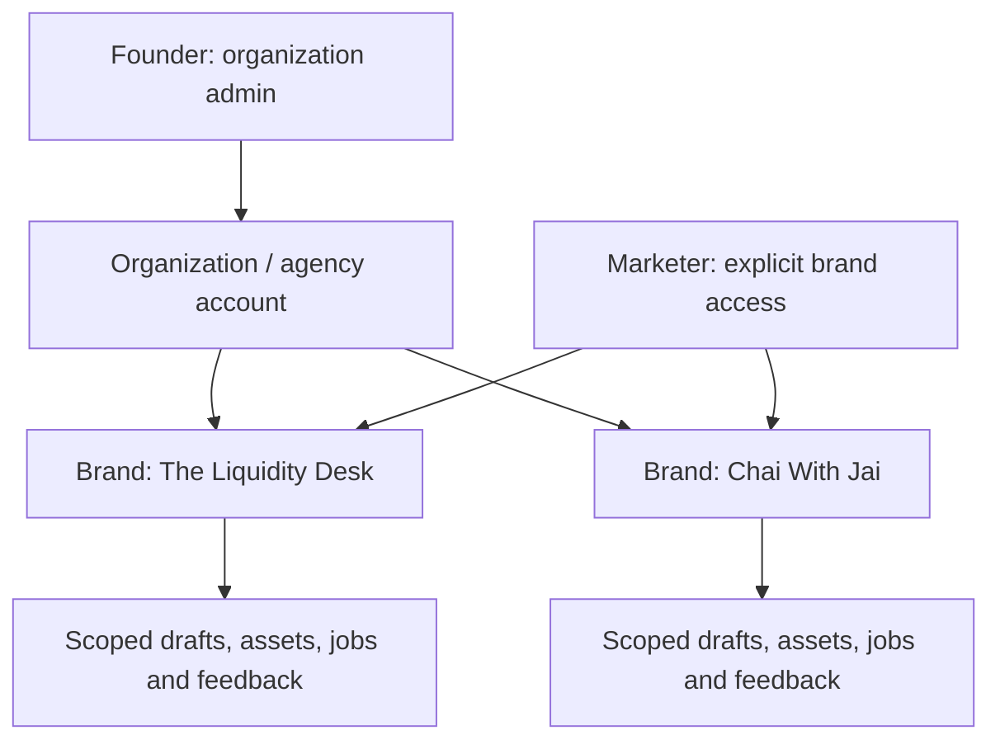

# Liquidity Studio capability map

Status: module order and epic execution authorized by the founder on 2026-10-17; Organization → Brand clarification implemented in the delivery branch. Local acceptance and independent review are underway, with final remote CI and cloud deployment evidence still required. GitHub Issues is the task source of truth, with #12 as the rolling tracker and #18/#19 as sprint items 12/13.

| Module id | Responsibility | Depends on | Issues |
|---|---|---|---|
| container-runtime | Reproducible local Docker, health, lifecycle and environment contract | — | #7, #11, #19 |
| durable-storage | Persistent scoped records, migrations, assets, backup and recovery | container-runtime | #2, #10 |
| identity-tenant-access | Organization membership, brand scope, least-privilege permissions | durable-storage | #4, #18 |
| operator-workflow | Brand kit, sourced backlog, preserved drafts, real export, calendar and batch workflows | identity-tenant-access | #1, #3, #5, #6, #8, #9, #10, #18 |
| gcp-pilot | Private founder-plus-marketer service, deployment evidence and rollback | operator-workflow | #19 |
| managed-billing-exit | Managed entitlements and usage, portable customer export and self-hosted recovery | gcp-pilot | #18 |

Build order: container-runtime → durable-storage → identity-tenant-access → operator-workflow → gcp-pilot → managed-billing-exit. The order above records the implementation dependency path. Authorized delivery continues through verification; it does not require reopening a superseded specification-approval gate.

## Pilot hierarchy

## Account and brand boundary

An organization or agency is the account tenant. It contains multiple brands. The pilot has one organization and two configured brand presets: liquidity_desk and vedic_dharma. Account brand IDs remain separate from those preset IDs. The founder administers the organization; the marketer is granted explicit brand access. Brand presets are configuration, not authorization.

Every data boundary carries organization_id and, for brand-owned data, brand_id. Membership checks use verified server-side identity. Resource lookup must bind both IDs; supplying another brand ID does not grant access. Caches, generated assets, job inputs, logs, usage events and dataset exports follow the same scope. Explicit service/admin jobs have narrowly granted scope rather than a process-global active tenant.

Do not introduce unbounded recursion for the pilot. Agency delegation across client organizations is a future explicit relationship with tested permission traversal; parent membership must not silently grant access to all descendants. This preserves a path to the founder's nested-tenant model without treating arbitrary depth as an implemented feature.

## Current evidence and remaining boundaries

The current delivery branch has canonical Svelte UI and Chromium tests, founder/marketer sessions and memberships, SQLite restart/recovery/concurrency tests, an async Firestore/GCS adapter with a real Firestore emulator contract, scoped jobs/telemetry/feedback, real PNG/ZIP/script export, measured simulation preflight, and portable manifests with explicit remapping/checksums. Local Docker acceptance verifies a real image, sign-in/isolation and retained records after recreation. CWJ positioning and five research tasks are present; unsourced or unreviewed clinical claims remain blocked.

This evidence does not establish a live GCP service, a configured working scheduler/source feed, paid provider connectivity, factual/clinical accuracy, activated billing, an unlimited tenancy hierarchy, or a selected license. Daily generation reservations are conservative attempt limits, not a dollar meter. Firestore has an explicit four-MiB aggregate-record capacity limit. Keep these distinctions visible when reviewing issue acceptance.

## Delivery evidence

1. Local container builds and serves the operator UI on an isolated loopback port; health and restart behavior are demonstrated.
2. Persistent records survive restart and restore; org/brand negative tests cover every API, object ID and background/export boundary.
3. Founder and marketer can complete the two-brand workflow with browser/visual evidence; Svelte changes use official MCP documentation and autofixer.
4. Only then validate a private GCP pilot against reviewed project, region, IAM, storage, secrets, rollback and cost settings.
5. Managed billing and customer ejection require reviewed entitlements, usage attribution, portable data/asset export and import validation.

## Commercial intent and pending decisions

The founder proposed $500/month plus a $1,500 bespoke setup fee, or $6,000 upfront. The upfront term, included usage, support, overages, taxes, and ongoing hosting responsibility are not yet specified. Clerk is preferred for identity and a billing integration; verify consumption-metering capabilities separately before promising them.

The repository is public, but no open-source or commercial license has been selected. Code ownership, customer self-hosting rights, contribution terms and managed-service rights need an explicit license decision; this document grants no license. The pilot must not depend on a billing purchase to authenticate its two invited users.

The original tenant handoff was a specification request. Multi-brand code now has implementation and test evidence described above; the handoff itself remains separate from that evidence. Medical, historical and numerical content claims need source review; keyword/number checks and synthetic examples cannot establish truth.
