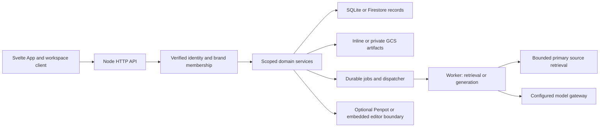

# System and change-impact map

Current source map, reviewed 2026-10-18. It describes implementation boundaries, not acceptance of every optional deployment. See the [capability index](capability-map.md) and dated evidence for delivery status.

## Follow one action: prepare a sourced preview

1. [App](../../liquidity-studio/src/App.svelte) retains selected scope/story/format in the [workflow URL](../../liquidity-studio/src/lib/workflow-location.js). The [workspace client](../../liquidity-studio/src/lib/workspace-client.js) carries current scope and revisions; it is not authorization.
2. [HTTP routes](../../liquidity-studio/server/index.js) authenticate and authorize the organization/brand before invoking [durable jobs](../../liquidity-studio/server/operator-jobs.js). A source-preparation job reserves existing attempt quota and captures input revisions/fingerprints.
3. [Dispatcher](../../liquidity-studio/server/job-dispatcher.js) and worker execution reuse durable job identity. [Preparation](../../liquidity-studio/server/source-preparation.js) retrieves the catalog-selected source through [retrieval guards](../../liquidity-studio/server/source-retrieval.js), validates the candidate and persists scoped evidence. [Candidate construction](../../liquidity-studio/server/prepared-source-candidate.js) is distinct from model generation.
4. [PreparedSourcePanel](../../liquidity-studio/src/components/PreparedSourcePanel.svelte) shows editable, unreviewed copy and source evidence. [Promotion](../../liquidity-studio/server/prepared-promotion.js) requires deliberate exact-copy review; clinical confirmation remains separate. Preparation completion does not approve claims.
5. A saved campaign can be handed to [Penpot story designs](../../liquidity-studio/server/penpot-story-design.js). Native edits remain in the native design; the Studio preview retains reviewed source copy. Create/Open, pairing and current brand access are separate checks.

## Predict the effect of a change

| Change | Likely downstream effects | Start with / checks and guidance |
|---|---|---|
| Story copy, title or source | Content epochs, candidate fingerprints, native-origin staleness, approval/export eligibility | `repository.js`, `story-content-revision.js`, prepared services; existing source/promotion/native contract tests |
| UI navigation or task controls | URL restore, dirty buffers, scope changes, pending operations, focus | App, workspace client, workflow-location; existing browser contracts and actual Neo task journey |
| Identity or brand grants | Every request/job, pairing, native admission and asset delivery | `auth.js`, `google-auth.js`, scoped services; [native access contract](../specs/identity-tenant-access-native-editor.md) |
| Store schema or asset reference | Transaction keys/capacity, backup, migration, portable export and rollback | `storage.js`, `cloud-store.js`, `repository.js`, editor-pack modules; [storage runbook](../firestore-gcs-storage.md) |
| Job/dispatcher behavior | Quotas, idempotency, cancellation, restart/rejoin and external calls | `operator-jobs.js`, `job-dispatcher.js`; [job spec](../specs/durable-operator-jobs.md) |
| Native hooks or fonts | Pinned upstream patches, actual native ACL/session/WS/assets, hosted artifact and license correspondence | `tools/penpot-*`, [upstream boundaries](../PENPOT-DOORY-UPSTREAM.md); native acceptance is separate from compilation |
| Frontend dependencies/build | Canonical distribution, Docker image, deployment asset identity | [Hosted assembly](../development/hosted-frontend-artifact.md), `.github/workflows/verify.yml` |

Paths in the table are under `liquidity-studio/server/` unless stated otherwise. Domain services enforce authority; storage prefix discovery and client-selected IDs never grant access. SQLite and Firestore have different operational/backup paths. A Firestore export does not copy referenced GCS bytes. Portable imports remap identity and retain historical approvals as evidence, not destination authority.
