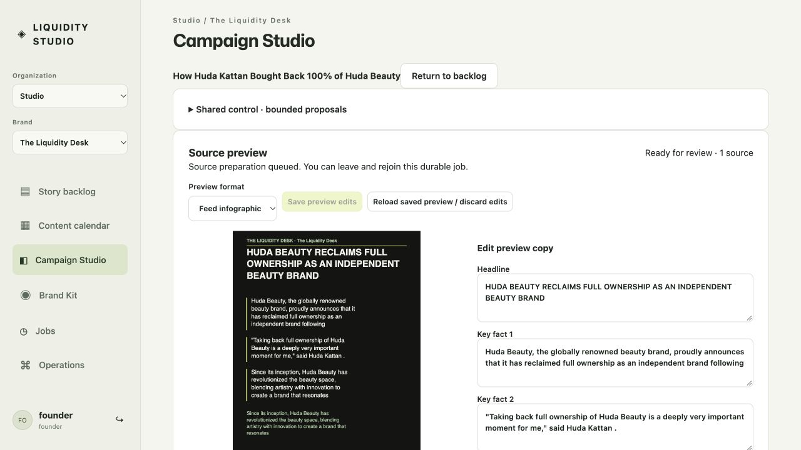
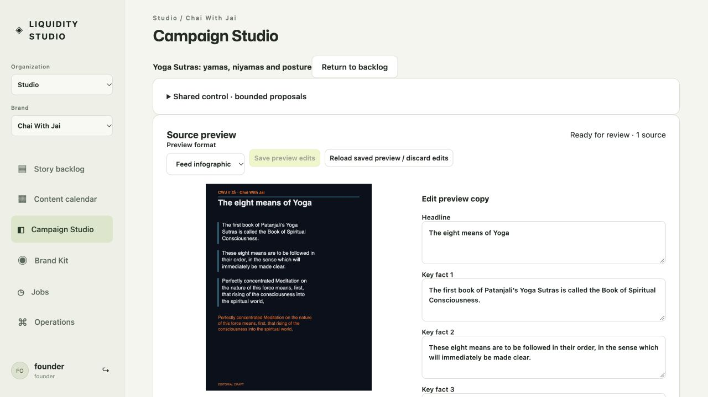

# Prepared-source pilot release

Deployed 2026-10-18. Implements the operator's annotation 1 and issue [103](https://github.com/ChaiWithJai/liquidity-studio/issues/103), following the responsive table, direct-copy and optimistic-calendar releases in PR110/PR112. Implementation and regression history are in [PR117](https://github.com/ChaiWithJai/liquidity-studio/pull/117); its final functional source is `0dea05bc9c1a4b8f5310f5afc7174863b3d39e41`, merged as `9a005d2aeae4414576a1caefbecbf32423ee2d7b`.

## Delivered behavior

Opening a prepared story shows its artwork beside editable copy. Evidence and unresolved questions are adjacent disclosures. Bounded HTTPS extraction runs in the existing durable job pipeline before the next operator opens these prepared stories. Saving, reopening, deliberate whole-copy review, handoff, and editing/reviewing an already reviewed draft preserve exact source/copy/generation lineage. Preparing material never supplies human approval or publishes it.

Three existing stories now have real retrieved primary-source candidates: Huda Beauty and Angel City in The Liquidity Desk; Yoga Sutras in Chai With Jai. Seven other seed stories require source research and remain honestly unprepared. The historical translation is cultural source material, not clinical evidence. Legacy financial/date/medical claims are not silently approved by retrieval.

## Actual runtime evidence

The same immutable Linux/amd64 image runs the local web and worker: `sha256:958e6ee2bff52d2f21a858e3b45480c4225337c3a7046b0a061d4db97c444e24`. Its 84 public frontend/server file hashes match the final source. To limit local disk use, it reuses the canonically built `27c4db0` dependency/runtime image with unchanged package/lockfiles, then replaces the complete public frontend/server trees. No held native source or credentials entered that context. Hosted CI separately passed the canonical Docker build for the final source.

The private registry digest is `sha256:859a373f13f5b7629d5699febe5f75115d82e991522a5ea8f4e6c9bd38b85d57`. Cloud Run revision `liquidity-studio-00019-gen` serves 100% at the [managed pilot](https://liquidity-studio-x4fdad2sga-uk.a.run.app/). Staging first opened under the real existing Google founder account, and anonymous state/preparation APIs returned 401. Existing Cloud Tasks, two worker scopes, service identity, min-zero/max-one bounds, 1 CPU/512 MiB and the shared daily limit were retained. No new paid model calls or editor cloud infrastructure were introduced.

The maintained local bootstrap completed three primary-source jobs. The host administrative cloud bootstrap refused managed-account verification before enqueueing anything; it was not bypassed. The current Google-authenticated cloud UI successfully queued the three preparations through the existing Cloud Run/Cloud Tasks service identity instead. [Actual managed worker readback](../design-review/issue-103/google-pilot-2026-10-18/managed-worker-readback.json) records all three completed items, source sizes/hashes, zero model calls and unreviewed status. The real Google browser opened both brands' previews and rejoined the saved cultural preview after a page reload.

[Local Huda](../design-review/issue-103/google-pilot-2026-10-18/local-huda.png) and [local Chai With Jai](../design-review/issue-103/google-pilot-2026-10-18/local-cwj.png) captures independently show the maintained Google-authenticated local application. Working content was not marked reviewed merely to produce these screenshots, and existing unsaved operator tabs were preserved.

## Verification boundaries and recovery

All five final-head hosted checks passed. Independent combined verification passed 293 Node tests with two emulator-dependent skips and eight Chromium journeys, including actual primary retrieval, same-revision/new-candidate dirty-buffer protection, ordinary pending versus unknown outcomes, lost save response, and stale review rejection. The [immutable-image acceptance](../design-review/issue-103/google-pilot-2026-10-18/isolated-image-acceptance.json) separately exercised both brands, actual worker retrieval, a real container restart/rejoin, edit/review/handoff and a second edit/review generation. That isolated password fixture is explicitly distinct from the real Google runtime captures. No two-human usability, fatigue, clinical-accuracy or publication claim follows from these checks.

Consistent local SQLite and successful full Firestore backups were retained before rollout. The prior local compose/image and Cloud Run `liquidity-studio-00017-wos` remain rollback points. Preserve candidates, immutable evidence and receipts; reconcile any pending preparations before reverting code. The web is healthy and the worker's three completed jobs prove execution; the worker has no Docker HTTP healthcheck, so Compose's aggregate `--wait` warning is not reported as a worker-health pass.

The original introduction was the manual source gate captured in annotation 1 on `a439acb`. Upstream dependencies are current Google identity, tenant scope, source-integrity, bounded retrieval and durable jobs; downstream dependencies are exact native binding, artwork approval/export and portable history. Those implementation and onboarding/learning criteria remain in their own tickets. Completion of this source-preview release does not close all of #52–#58, #30 or the rolling ownership queue #12.
