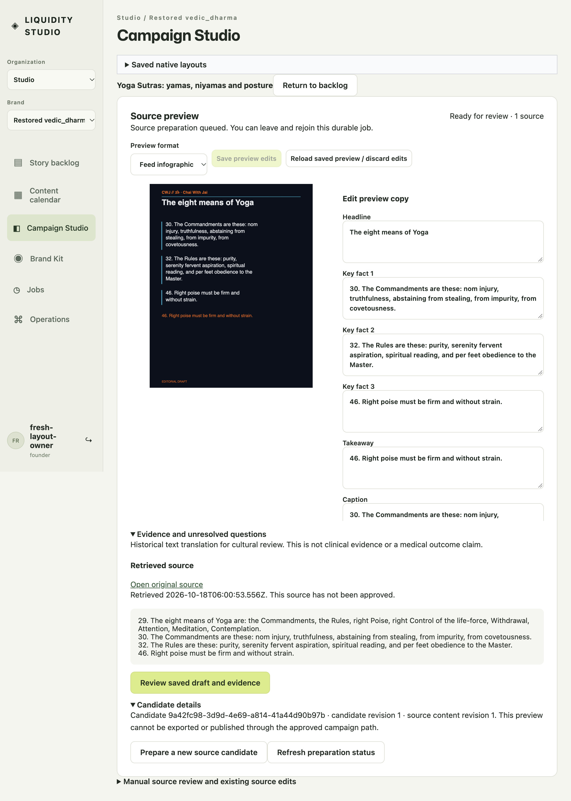

# Selected Yoga passage: actual browser acceptance

On October 18, 2026, BrowserOS Neo opened a fresh Yoga task in an isolated,
disk-backed Studio fixture at source `e49dab5e2a5028071d5203c67eb831227e9f202e`
and loaded `index-C318n7X3.js`. The operator clicked **Prepare source preview**.
The official local durable job service used the default real HTTPS retriever,
restricted to source preparation in the owned Chai With Jai scope. No text
retriever was substituted and no inference or paid provider was called.

The source was the [Charles Johnston translation via Project Gutenberg](https://www.gutenberg.org/cache/epub/2526/pg2526-images.html).
The retrieved evidence contains only the selected Book II paragraphs **29, 30,
32 and 46**. The actual preview headline is **The eight means of Yoga**; its
three fact cards come from paragraphs 30, 32 and 46. The introduction and later
book discussion are absent. Source spelling was retained rather than silently
edited.

The browser read back `extractive-unreviewed`, `humanApproval: none`, provider
`none`, `modelCalls: 0` and `requiresReview: true`. The candidate was not promoted
or approved. This is cultural source preparation, not clinical evidence or a
factual-accuracy score. [The sanitized browser report](result.json) records the
actual response/text hashes, retrieval time and candidate evidence.

The passage implementation files `source-catalog.js`, `source-retrieval.js`,
`source-preparation.js` and `prepared-source-candidate.js` are unchanged between
the reviewed combined source `ce314` and `e49dab5`. Existing hosted source and
regression checks remain separate evidence; no local test runner was started for
this checkpoint.

The full-page screenshot uses the actual **1051 × 868 viewport, DPR 2**. It does
not substitute a 1280-pixel baseline. Authentication is an explicit local password
fixture; no current Google sign-in or maintained-runtime acceptance is claimed.
This validates the original selected-passage behavior from issue [127](https://github.com/ChaiWithJai/liquidity-studio/issues/127).

The [original capture](preview-with-prior-notice.png) also preserves an unrelated
success notice left over from reviewing another story. The operator dismissed
that notice for the clean screenshot above. The Yoga panel and stored candidate
remain unreviewed in both captures. Clearing that stale global context is a
separate maintenance fix, not a source-approval bypass.
