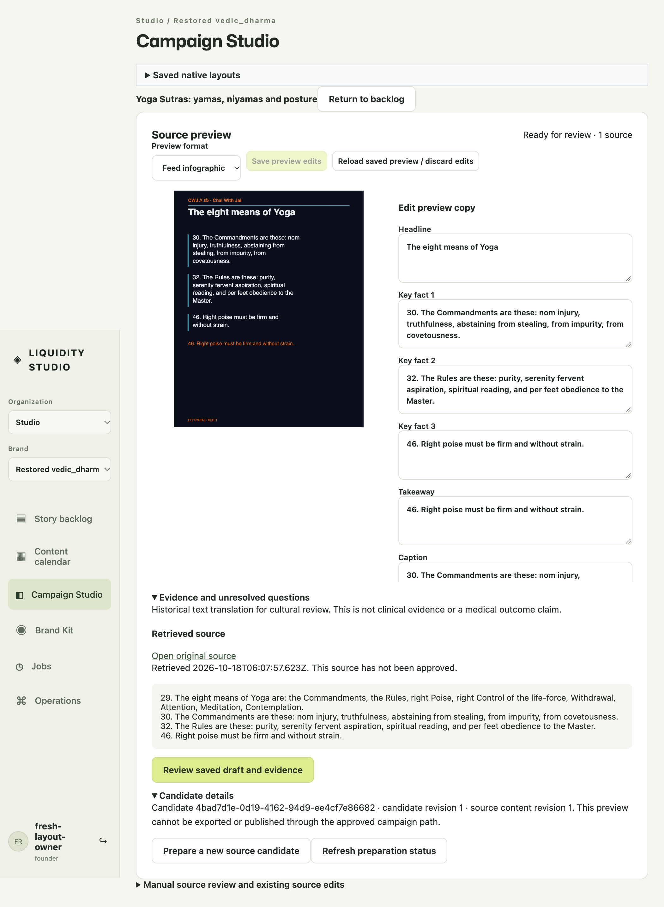

# Notice context: BrowserOS Neo acceptance

The original [issue-127 capture](https://github.com/ChaiWithJai/liquidity-studio/blob/978397a/docs/design-review/issue-127/neo-real-source/preview-with-prior-notice.png)
shows two stale notices above a correctly unreviewed Yoga candidate: a previous
story's review success, and preparation-queued text after the candidate is ready.

The bounded fix clears the global success notice only when selecting a different
story ID. Same-story adoption keeps its normal feedback. The preparation panel
clears only its known queued notice when the existing server status becomes
`ready`; it leaves dirty-buffer conflicts, dispatch warnings and approval state
unchanged.

BrowserOS Neo loaded `index-BWJKhL1L.js` in the owned disk-backed fixture. An
actual same-story controlled-copy review showed its success notice. Opening the
different Yoga task removed that prior-story banner. A deliberate new preparation
used the real HTTPS source worker and returned a different candidate ID. Once it
was ready, the queued notice was absent; stored provenance still read
`humanApproval: none` and `modelCalls: 0`.

The actual viewport is 1051 × 868, DPR 2. [The browser readback](result.json)
records both positive same-story feedback and the two corrected final states.
The short queued transient was not separately captured. The fixture uses explicit
local password authentication, not a new Google acceptance claim. Its verified
private SQLite backup preceded an owned-service restart; the persisted session
and source preview survived that restart. Maintained Studio services were untouched.

Official Svelte review reports no issues. The App retains its same 18 preexisting
suggestions; the prepared-source panel has no suggestions. The ordinary audited
production build passed. No local test runner or private vendor build was used.
