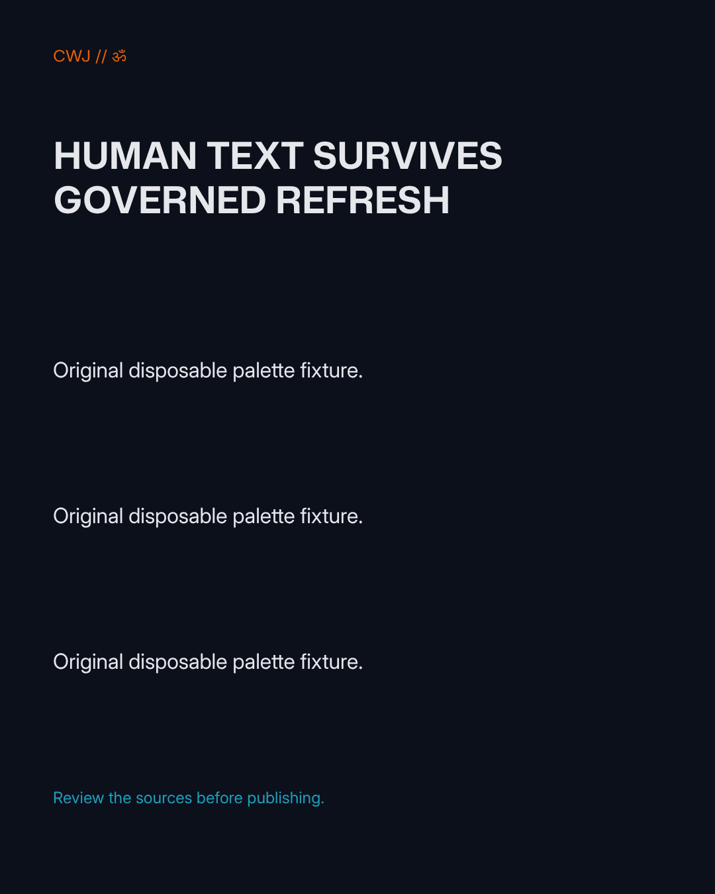
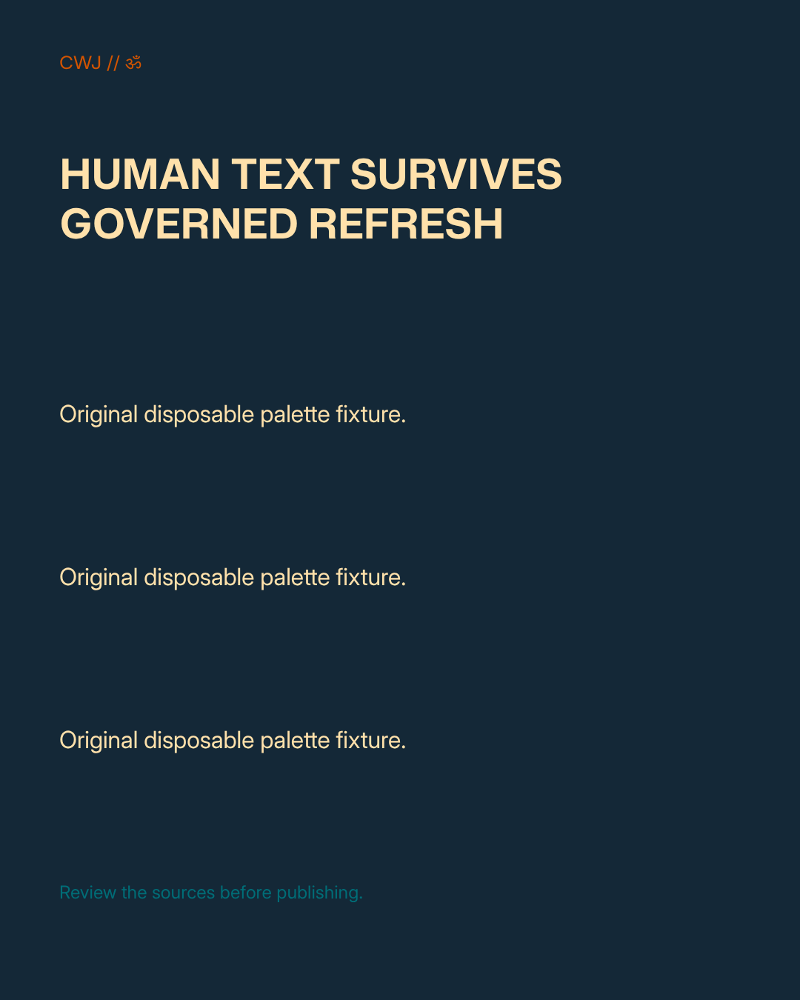
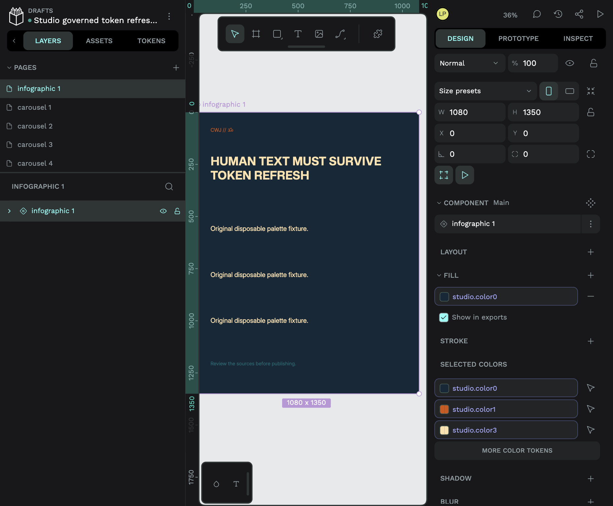
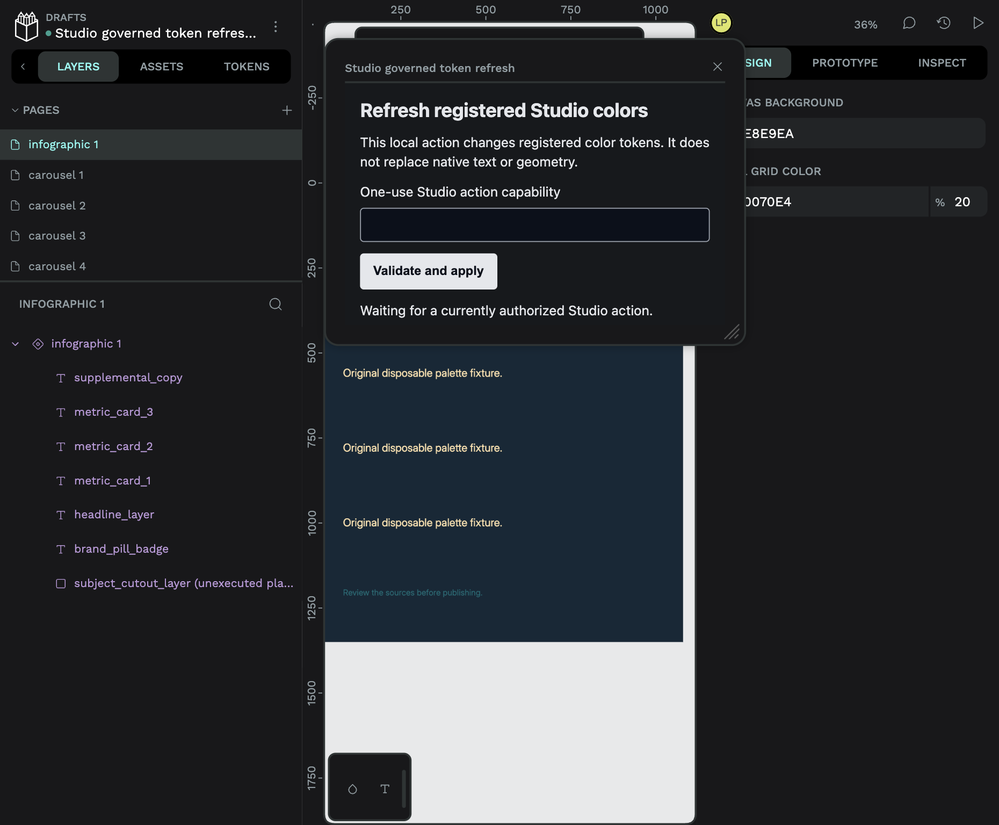

# Registered native token refresh and font recovery

This optional local Penpot 2.18.3 path updates registered color tokens through the public native plugin API, then independently reads saved tokens and bound paints before returning a native-state receipt. It does not replace native rich text with a server snapshot. The current Studio/Doory path and the Google pilot remain unchanged.

## Observed acceptance

A real BrowserOS neo session signed into the disposable Studio fixture on port 39020, selected CWJ, edited all four Brand Kit colors and saved. Its existing scoped editor-bindings HTTP route returned `pending-native-action`. In a separately signed-in local Penpot QA session, the installed plugin claimed that server-owned action, changed the four tokens and reaffirmed the already-active registered theme. Native persistence advanced from revision 3 to 4. The independent native reader verified the four saved values and every registered bound paint across nine pages.

Before that refresh, the native Text tool changed the headline to `HUMAN TEXT SURVIVES GOVERNED REFRESH`. All 50 text shapes retained their exact text, shape identities, page order and geometry. Actual authenticated exporter PNGs are1080×1350; all four new palette colors occur in the after PNG. The background changed, so every pixel differs. This is an actual palette change, not a screenshot-only recoloring.

| Before native action                            | After native action                           |
| ----------------------------------------------- | --------------------------------------------- |
|  |  |

[Machine-readable observations](acceptance.json) include the two PNG checksums. The actual protocol used an explicit password/test Studio fixture and real local Penpot QA accounts. It is not production Google identity acceptance. A native-state receipt is neither editorial approval nor publication approval; visual/export verification remains separate.

The initial plugin experiment changed token records but left paints unchanged. The verifier correctly refused acknowledgement. Pinned source inspection and the corrected experiment showed that `Token.value` updates the library record, while reaffirming an existing active `TokenTheme.active` dispatches native propagation. Merely sending `set-token` over remote RPC is insufficient.

## Why the native action is necessary

The pinned backend rejects incoming file revisions greater than the stored revision; older revisions are intentionally merged. A read followed by remote `set content` is therefore not an atomic compare-and-swap. Replacing rich text to change its fills could overwrite a newer human edit.

The plugin instead uses native current-state propagation. It validates the current native file and profile, the registered token/set/theme IDs, exactly four color tokens, one already-active theme and one active set. It refuses a mixed active catalog, so a color refresh cannot also propagate unrelated sizing or typography tokens. It never writes text, geometry, arbitrary native changes, URLs or credentials.

Primary pinned sources:

- [Native revision handling](https://github.com/penpot/penpot/blob/ff7a66f51938b2293260ea27a64e2c4e0833b5e3/backend/src/app/rpc/commands/files_update.clj)
- [Plugin token and active-theme setters](https://github.com/penpot/penpot/blob/ff7a66f51938b2293260ea27a64e2c4e0833b5e3/frontend/src/app/plugins/tokens.cljs)
- [Token record updates and theme propagation events](https://github.com/penpot/penpot/blob/ff7a66f51938b2293260ea27a64e2c4e0833b5e3/frontend/src/app/main/data/workspace/tokens/library_edit.cljs)
- [Native current-state propagation](https://github.com/penpot/penpot/blob/ff7a66f51938b2293260ea27a64e2c4e0833b5e3/frontend/src/app/main/data/workspace/tokens/propagation.cljs)
- [Official plugin installation and permissions](https://help.penpot.app/plugins/getting-started/)

## Authorization and completion boundaries

`PenpotTokenRefreshTransport` is constructor-injected into the existing #52 boundary. The operator registry supplies native owner/project/file/version and the source/font/layer manifest. HTTP callers submit only:

```json
{
  "operation": "refresh-brand-tokens",
  "storyId": "current-story-id",
  "expectedRevision": 1,
  "generationId": "persisted-generation-id",
  "expectedBrandRevision": "current-bootstrap-brand-sha256",
  "expectedNativeRevision": 3
}
```

The action uses `kind: "tokens"`, `action: "write"` and the resource ID already registered under the binding. The server compiles the current persisted approved source and brand through #51. Actor membership, binding epoch, source/story/generation/brand revisions and native owner/project are checked again at claim and acknowledgement. Production wiring must supply `createPenpotActorAuthorizer`, which reuses managed Google account lookup and revocation policy without retaining a user JWT. The explicit local reproducer substitutes only its isolated test actor, not a fake managed Google identity.

The one-use capability lasts at most 60 seconds and is stored only as a digest in memory. Claims reserve the action before asynchronous checks, reject replay, and fail after restart. No grant, owner session or authority is added to portable scope data. Native owner sessions stay constructor-only. The native reader uses only fixed localhost:39008 RPC URLs, bounded JSON and no redirects. The plugin host binds loopback port 39019, serves a static allowlist, validates Host/Origin, limits bodies and requires the capability for action endpoints.

The receipt remains pending until independent saved-state token and paint checks pass. It always reports `pixelsVerified: false`, `editorialReviewRequired: true` and `publicationApproved: false`. Expiry/revocation prevents subsequent claims or acceptance. A native action already claimed can finish before a later revocation; there is no instantaneous remote rollback guarantee. Reconcile an unknown outcome against current native state before creating a new action.

Equivalent font fallback-list normalization in Brand Kit is checked against the compiler's actual verified font bindings. A real font change is rejected and requires a verified native rebind instead of silently substituting another font.

## Fonts travel in an outer recovery pack

A native `.penpot` archive does not itself contain the custom font binaries. The new outer pack carries the actual archive, source OTF/TTF bytes, full OFL text and SHA256 checksums. The local recovery tool accepts only the four pinned repository source variants. It creates a new owned QA team, confirms that team starts with zero font variants, imports the archive into its new project, uploads source bytes, reads them back by native resource ID, checks their hashes and rebinds native text references to the new team-local font IDs. It cannot select an existing interactive target.

The public recovery script was executed for CWJ and Liquidity Desk. [All 18 actual fresh-team PNG exports](fresh-font-matrices.json) completed at their expected native dimensions, including all three static timecoded reel boards per brand. Each new team started with 0 variants and received 4 verified source variants. Each restored document has 9 pages and 50 native text shapes; 100 font references were rebound. The CWJ fresh-team native browser visibly renders the preserved human headline and active color bindings:



The first CWJ recovery PNG renders every text line at1080×1350. Its source and recovered PNGs are visually consistent but **not byte-identical**:4,414 of 1,458,000 pixels differ, bounding box(81,73)–(819,1218). The cause of this small rendering difference is unconfirmed. Do not describe it as exact pixel fidelity. The earlier raw-SVG repair's byte-identical PNG result is a separate experiment, documented in [the preserved SVG restoration record](../svg-restore-v1/README.md).

The font-only archive gate checks `penpot/export-files` version1 generated by Penpot 2.18.3, bounds ZIP expansion and records, and rejects external media, raster/image paints, raw SVG, external libraries, unknown entries and path traversal before any native mutation. Generated native thumbnails are explicitly distinguished from source media. Unsupported external artwork is rejected, not represented as a complete portable backup. No Studio credentials, grants or memberships are restored from the pack.

## Reproduce locally

Use the already-pinned owned Penpot stack. No image build, pull, cloud resource or paid provider call is required. Supply private mode 0600 QA account/font manifests and a fresh private state directory:

```sh
NODE_ENV=test node scripts/investigations/penpot-token-refresh-local.mjs \
  --account-file /private/fixture-accounts.json \
  --anchor-file OWNED_QA_FILE_UUID \
  --fonts /private/verified-fonts.json \
  --state-dir /private/fresh-token-fixture
```

The script verifies the native owner and served source font bytes, creates one new native fixture and an isolated SQLite test Studio, and writes random local test credentials to `operator.json` with mode 0600. It exposes Studio port 39020 and the plugin manifest at `http://localhost:39019/manifest.json`. No password-mode option is enabled in the current pilot.

1. Sign into the disposable Studio using that private file, select CWJ and save new Brand Kit colors.
2. Edit native text in the new Penpot fixture with the Text tool; wait for its actual saved revision.
3. Submit the command above through the existing scoped registered operations route, using current bootstrap and native revisions. The response's capability is private and short-lived.
4. Install/open the local plugin through Penpot's plugin manager, paste that capability and choose **Validate and apply**. Acceptance requires the independent readback receipt, then native browser/export inspection.



For licensed font recovery:

```sh
node scripts/investigations/penpot-font-pack.mjs create \
  /private/native-export.penpot /private/verified-fonts.json /private/outer-pack.json
python3 scripts/investigations/penpot-font-recovery-local.py \
  --account-file /private/fixture-accounts.json --pack /private/outer-pack.json \
  --evidence-dir /private/fresh-recovery --node /path/to/node22
# Validation above makes no native mutation. Add --apply to create a new owned QA team.
```

The recovery target is quiescent and newly imported. Its content/font rebind is not offered as a concurrent live-document mutation. Native browser, PNG and SVG review are separate from an import RPC's success.

After a fresh font rebind, open each recovered page through the native editor's page list and allow the document to save before SVG export. This runs Penpot's own text layout; the recovery code never invents glyph positions. Full URL reloads performed too quickly can discard pending native layout saves. The read-only SVG reproducer therefore rejects a target page with missing saved `positionData` before requesting an export. In this experiment the initial first-frame SVG export failed while layout was absent; opening that page in the actual editor saved six text layouts and the same SVG export then passed. The full matrix result is recorded separately rather than inferred from this first-frame result.

## History, dependencies and remaining integration

The operator-owned identity/asset boundary entered at `f3b7f4d`, with pre-dispatch reauthorization corrected in `7311dd5`. Native editable shapes and active tokens entered at `4490a40`; `7655e6b` added source-copy guards and the earlier same-team 18 PNG roundtrip evidence. Those commits supplied the upstream pieces but did not provide a governed live Studio-to-native refresh or fresh-team font recovery. This change adds those optional local action/recovery pieces without replaying the whole compiler output over human edits.

#51 supplies authoritative content, #52 supplies identity and target authority, and future #56 approval must separately bind the resulting native version/hash. No App mount, default Penpot transport, public endpoint, production Google/native session exchange, motion, cutout or general external-media packaging is claimed here. The optional native host in #95 remains separate. Issue54 requires the complete acceptance chain and must not be closed merely because these local pieces pass.

Rollback is to omit this transport and stop only the two disposable local Node listeners. Existing Studio/Doory documents, native originals, preserved broken imports and native volumes remain intact.

## Final native recovery and second-brand checkpoint

The disposable finance Brand Kit flow also saved all four colors through the actual Studio form, submitted the registered scoped operation and applied it through the native plugin. Independent saved-native verification acknowledged revision 3 to 4. All 50 text shapes, shape IDs, page order and geometry remained unchanged, including the native human edit `FINANCE HUMAN TEXT PRESERVED`. Equivalent UI normalization of font fallback lists resolved to the same verified native font family/weight; an actual font change remains rejected until a verified rebind. See [finance acceptance](finance-acceptance.json).

After fresh-team font recovery, actual native page-list navigation and save produced native text layout for every page. All **18 native SVG exports** then passed: [CWJ matrix](cwj-fresh-font-svg/svg-matrix.json) and [finance matrix](finance-fresh-font-svg/svg-matrix.json). The SVGs contain native vector output rather than unrendered foreignObject text. Their successful export does not establish exact pixel equivalence or package arbitrary external media. The corresponding 18 PNG artifacts are in `cwj-fresh-font-png/` and `finance-fresh-font-png/`.

The earlier export failures remain part of the evidence: missing saved native layout after font rebind led to exporter text-node timeout. One-page native layout made that same SVG export succeed; all-page native navigation and save enabled the complete matrix. Rapid full-page reloads were not a valid substitute for allowing native pending changes to save. This is a local recovery prerequisite and explicit preflight guard, not an upstream automatic import fix.


Native exported SVG styles still reference the recovered team's loopback font assets. These raw exporter SVGs are **not self-contained distributable font packages** and require those served font URLs for their specified faces. The outer recovery pack separately carries licensed source font bytes and the tested fresh-team rebind path; PNG output is self-contained. No claim of offline standalone SVG font embedding is made.
