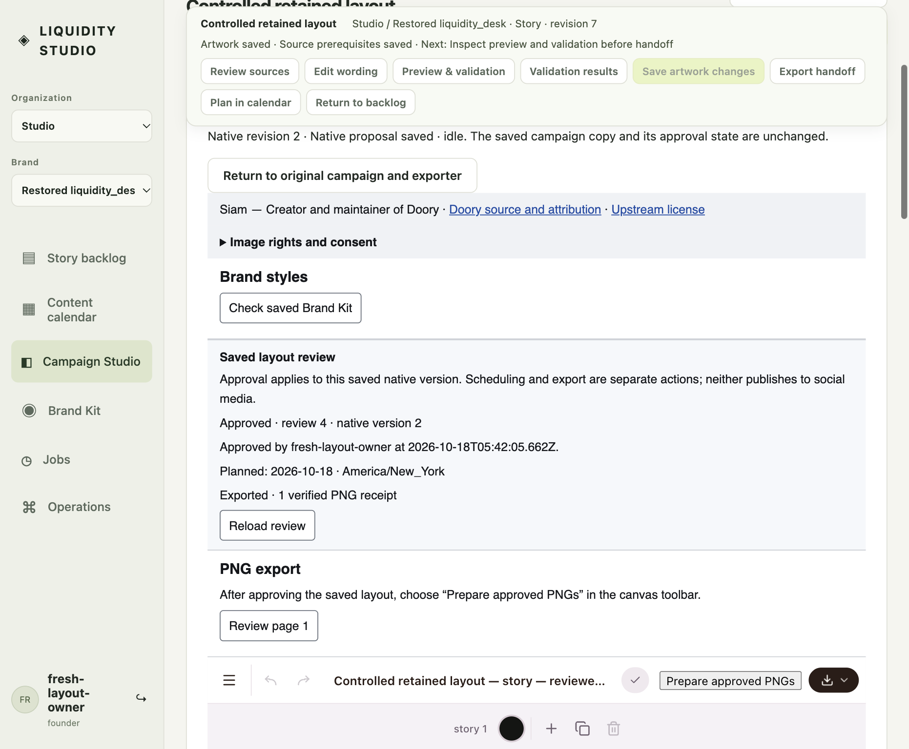

# Scheduling and approved PNG export in both orders

On October 18, 2026, BrowserOS neo exercised both orders through the actual Studio UI and the existing private native EditorApp. This is an additional issue #56 acceptance observation, not a production or Google sign-in test.

| Actual UI order | Observed result |
| --- | --- |
| Calendar plan → review → export | Feed proposal planned for October 17 in America/New_York, then explicitly advanced through review and approved. Native PNG preparation, private preview, deliberate PNG signoff and download produced one verified receipt. |
| Review → export → calendar plan | An independent Story proposal was approved and exported while planning was empty. Subsequent October 18 calendar placement preserved Approved review 4, native version 2, the generation and content epoch 2; readback reported `stale: false` and one receipt. |

Scheduling changed the story's planning revision, not its content epoch. The second proposal remained approved after planning; neither operation published to a social network. The UI displayed approval, planning and verified export as separate facts. The first proposal's October 17 readback was preserved before unassigning that campaign to exercise the second order.

Both actual downloaded PNGs matched the private preview and persisted receipt hashes:

| Artifact | Dimensions | Bytes | SHA-256 |
| --- | --- | --- | --- |
| Feed, plan first | 1080 × 1350 | 143060 | `53f1a5d477e25703dcf3f9423ff594737d6646939b89407e933ac30fc76769f6` |
| Story, export first | 1080 × 1920 | 114025 | `5550f69e15d6b45b34c9bcbad6da30f18603801b241ca0ebe3b1a0bf7c93e63b` |

[Sanitized evidence](evidence.json) retains proposal/generation identifiers, exact bindings, one-receipt readbacks, artifact measurements and source hashes. It contains no credentials, signed envelopes, MACs or nonces. Downloaded fixture artwork remains in the operator's private evidence directory; the screenshot below is the unchanged Neo capture.

The screenshot is 1862 × 1536 pixels from a 1051 × 868 CSS-pixel viewport. Neo group `approval order qa` and page 108 are ephemeral coordination identifiers, not confidence scores.

## Source and limits

The fixture served source tree `ab31ca143781f37b2002f0c83dd82f25256f0b4b`, including the not-yet-merged historical native-layout rebind UI. The four approval/export/content-epoch modules listed in the evidence JSON are byte-identical to main `954019d`; their SHA-256 comparisons are recorded explicitly. The existing private frame was built from `4d1e30ee4d1690999337ed83d165d71b90abe23d`, with upstream pin `27b6f68221fdbf1ef1bedc182e303210ca9e39f5`. This does not establish that the entire fixture tree or private frame equals main, nor authorize distributing held upstream code.

This used an existing loopback HTTP/in-memory fixture, a local password founder and controlled nonclinical source text. It does not demonstrate Google authentication, cloud durability, factual or clinical approval, publication, all media formats, or broader issue #57 completion. No new uncertain-response fault was injected; earlier replay evidence remains in [the verified native PNG report](../verified-native-png.md). No Node tests, Playwright, new browser process, dependency installation or native rebuild was run for this observation. The shared fixture authentication slot was released after capture; subsequent work used only offline file inspection.
