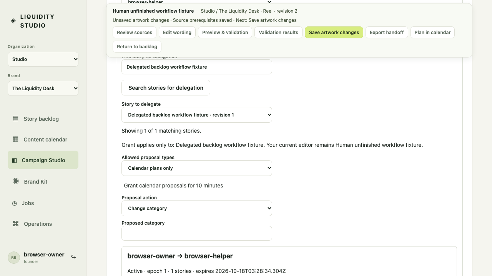
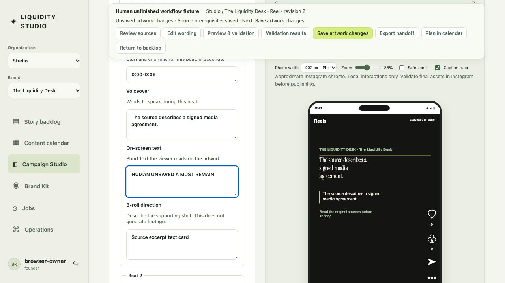
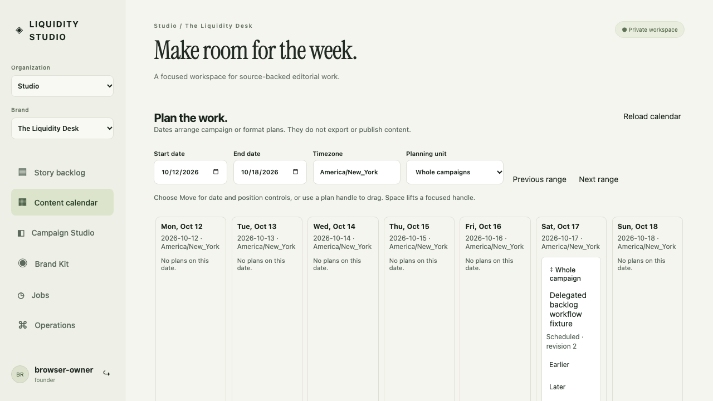

# Cross-story delegation checkpoint

This version adds actual authenticated two-person browser evidence to the existing [operator workflow](../../issue-69/2026-10-18/) and [scripted protocol](../scripted-v1/) records. Original screenshots and canonical scenario IDs remain unchanged. Captures are 1280 × 720, DPR 1, from a production-built App with ephemeral HTTP/SQLite and controlled editorial fixtures. See the hash manifest and role-specific journey reports.

## Problem and change

The initial shared-control UI (`e0d47c8`) granted only its displayed story. Calendar controls (`8c536ea`) retained that restriction, although the server already supported explicitly bounded story IDs. An operator editing story A had to leave that context before granting work on story B.

The picker now searches the current authorized brand through the existing workspace query API and requires an explicitly selected returned stable ID. It does not merge lookup rows into the canonical story cache. Changing the query clears its selection. Canceled, failed, or late old-scope responses cannot restore an old choice. Membership, grant bounds, exact approval, revisions, expiry and execution remain server decisions. No App mount, source-approval, generation or calendar authority changed.

## Completed journeys

The browser test runs both directions: founder edits A while marketer works on B, then marketer edits A while founder works on B. In each run:

1. The first person leaves a Reel text edit on A unsaved and explicitly grants calendar proposals for B.
2. The second person opens B, observes its real current revision and calendar bucket, and proposes placement. B has no campaign and its source remains unreviewed; generation remains disabled.
3. The owner approves that exact proposal. The second person applies it. The owner remains focused in the unchanged dirty editor for A with its original base revision.
4. The second person reloads and sees the durable receipt. The owner finds B's new canonical revision and Scheduled state in the table and its actual dated calendar placement, then returns to the unfinished A edit.

Each completed path contains 32 explicit semantic actions by inspection of the executed test calls, excluding authentication, fixture setup, assertions, HTTP observations and screenshots. This is a source-call count, not runtime event telemetry or a human effort measurement. UI context transitions are four for the first person and three for the second, including the explicit reload/return. There is no claim that these counts reduce fatigue or outperform another product.

`tests/helper-delegation.spec.js` also exercises cleared selections, a controlled lookup failure and a held old-brand response released after switching brands, and a held lookup released across sign-out followed by a different authenticated principal. Existing mounted helper tests also cover canonical dirty-buffer reconciliation.

## Acceptance reconciliation for issues 69 and 70

| Requirement | Evidence and boundary |
| --- | --- |
| Source → draft → edit → preview → assignment → handoff → unfinished return | Issue 69's existing two-role production-App journeys and original S03/S08/S19/S21/S23/S04 captures; this slice adds cross-story delegation without replacing those records. |
| Readable field labels, persistent task context, reachable validation | Merged issue 69 taskbar and actual sticky geometry/keyboard focus regressions, including wrapped narrow layouts. |
| Explicit shared owner/helper control | Real principals, explicit grant/approval/apply, epoch pause/takeover and calendar regressions. Client presence labels are advisory, never authentication. |
| Work on B while A remains unfinished | New S16/S23/S04 captures and both-role persisted revision/dirty-focus assertions here. |
| Helper protocol failures and uncertain writes | Existing scripted-v1 evaluation and mounted same-intent retry, stale revision, foreign scope and pause tests. |
| Candidate model evaluation | [Bonsai evaluation](../bonsai-v1/) measured a real candidate and rejected it for autonomous actions. It was native MLX, not browser WebGPU. No model is promoted by this picker. |
| Walk away and return to durable generation | Separate issue 71 job/worker acceptance; this pane does not pretend browser-driven semantic actions continue after its tab closes. |
| Human usability and autonomous visual helper | No human attention study or accepted autonomous visual model is claimed. Existing failed candidate results remain failures. |

This is a source/browser checkpoint. A new combined immutable-image acceptance and deployment are still required before claiming this picker is available on the maintained local/cloud release. No production image, cloud traffic, real Google account or customer data changed during these tests. Neither issue is closed by this document.

## Representative original captures

