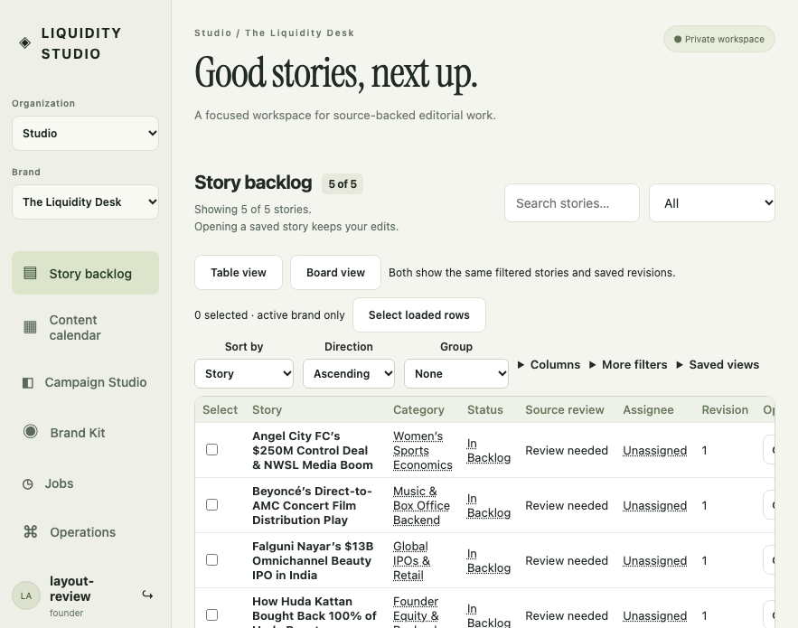
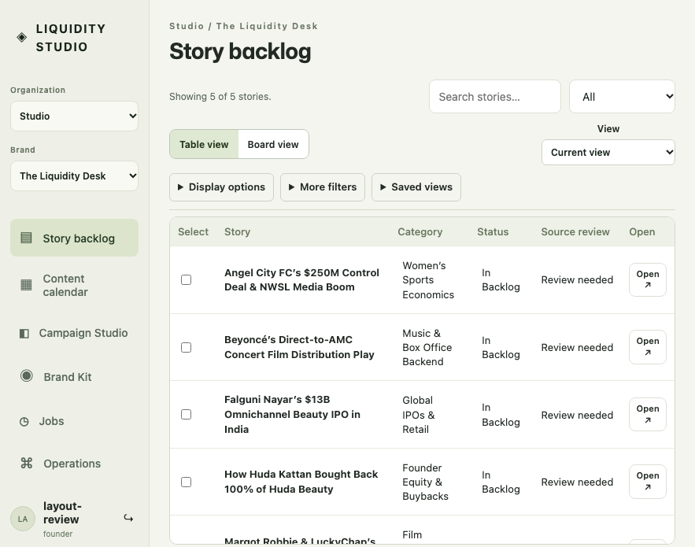

# Operator task hierarchy and work-table revision

Issues [105](https://github.com/ChaiWithJai/liquidity-studio/issues/105) and [106](https://github.com/ChaiWithJai/liquidity-studio/issues/106), parent 39. This version addresses the founder's annotations 1–4 without rewriting the original canonical review annotations.

## Evidence and history

The product was exercised at the reported logical 883 × 695 viewport and at 1280 × 720, DPR 1. `before/` contains actual Chromium captures of the unchanged production build at `add4b3f` (merged 102). That build retains the same table/header problem reported on `a439acb`; intervening native-review and delegation work did not redesign those surfaces. The baseline is an ephemeral authenticated HTTP/SQLite fixture, not a capture of the founder's Google session.

The slogan originated in the canonical Svelte migration `754f042`. The work-table toolbar arrived with `9d5d114`. Later fixes `32eec46` and `d23dbc5` preserve immediate saved-view intent and focus during delayed canonical reordering; this change retains those behaviors. Dependencies are the existing scoped workspace query/operation/view client, server revision/receipt contracts and native Svelte 5/HTML controls. No new UI package, query engine, authentication or domain API was introduced.

## Hierarchy and task copy

- The page heading names the task: Story backlog, Content calendar, Campaign Studio, Brand Kit, Jobs or Operations. The permanent private-workspace badge, page slogans and repeated generic descriptions are removed.
- Backlog search/status and one announced result count precede Table/Board and the saved-view chooser. Sort/group/columns, additional filters and saved-view management are secondary expandable sections. Expanded sections stay in document flow rather than overlapping rows or clipping a floating menu.
- Titles receive more space. Cell edits remain keyboard-accessible buttons with visible focus, but no longer resemble underlined prose. Bulk actions appear after selection. The table header retains a select-page action, including the existing 25-item guard.
- New default views contain Story, Category, Status and Source review. Assignee and Revision remain optional columns; existing explicit saved definitions are not rewritten. Stable IDs and row revisions remain in the canonical data and DOM attributes.
- Campaign help moves beside the task into an expandable help section. Dirty state, source blockers, revision conflicts, validation, approval, download and recovery information remains visible when relevant. Brand research keeps its unreviewed distinction. Jobs use human-readable date/state/count labels, with technical identities available in details rather than as the primary task name.

This is a task hierarchy change, not a claim of measured human productivity. It does not remove deliberate source review, save, explicit assignment or export boundaries.

## Browser verification

`tests/workspace-table.spec.js` covers both exact viewports, collapsed/default and expanded display/filter/view sections, optional columns, board, Campaign Studio empty state, Brand Kit, Jobs unavailable state and Operations. It checks page overflow, reachable controls and input bounds. Separate held-response cases capture pending rows, no matches, a truly empty brand, a controlled query failure and successful retry.

Existing table journeys retain search/open/detail-edit/return, saved-view create/update/delete/restore, grouping, metadata selection/bulk conflicts, uncertain same-key retry, dirty detail/inline revision bases, external rename reconciliation, immediate-before-debounce view saves and both delayed-sort focus cases. Tests explicitly open Display options before using its moved controls; the previous assertions and timeouts remain intact. Job history tests select the same durable ID through `data-job-id` rather than requiring it as visible primary prose.

The complete production build, official Svelte checks, scoped client/domain tests and browser results are reported on the pull request. `manifest.json` pins source, built asset identities, original PNG dimensions and hashes. All captures use disposable provisioned founder fixtures, with no paid generation, customer data or new Google account claim.

## Comparison and release limits

Compare `before/883-backlog.png` with `after/883-backlog.png`, then the expanded controls and state captures. The exact requested viewport shows the baseline's stacked slogan/count/selection/settings layers and the new primary work surface. Desktop captures document the same hierarchy rather than a separate feature variant.

Calendar logic and its task-specific copy are coordinated separately with issue 104. Native editor review and prepared-preview work retain their independent acceptance. These source/browser captures are not a claim that the maintained Docker or cloud release has changed. A combined immutable build and release verification remain necessary. No human usability, accessibility certification or fatigue reduction is claimed.

## Frozen validation

Functional source `8190ae0f1bc05b44759dccf6bb229cb03ea28e4a`, combined with merged review transitions (108): 68 browser cases passed in 2.1 minutes; 11 explicit skips cover the two separate Google Auth Emulator and nine opt-in licensed native-editor journeys. The 17 scoped workspace client/domain checks passed. Official Svelte checks reported no issues in App, WorkspaceTable and JobsPane. Hosted CI and independent release verification remain separate gates.

Default backlog and Saved views before/after pairs use the same five seed stories and disposable `layout-review` account. Other after-state captures come from the real functional suite, which deliberately creates/edits additional rows and switches brands; their counts and contents are not a controlled productivity comparison. `all-settings` records multiple expanded sections; the other files preserve individual observed task states. Board select-all remains reachable in Board view and its selection resets on brand switch, with fresh-brand selection tested at both viewports.

