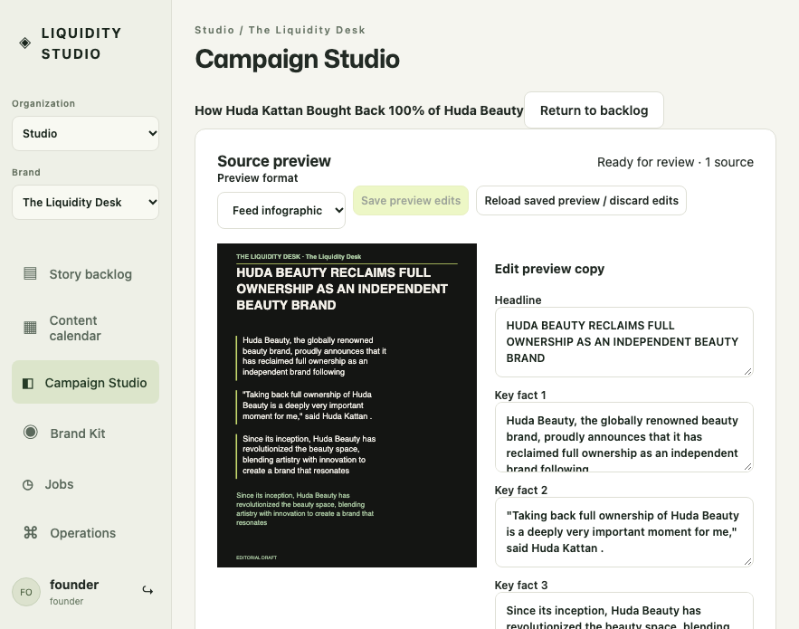

# Prepared-source flow: bounded implementation evidence

Issue [103](https://github.com/ChaiWithJai/liquidity-studio/issues/103), annotation 1. The new flow opens a persisted, editable artwork preview with retrieved source material before the manual approval form. Preparation never labels excerpts as verified facts. The compact capture uses the same annotation ID and viewport as the reported problem, with a newly prepared disposable fixture; it is not a claim to reproduce the founder's current private edits.



[Capture metadata and hashes](prepared-source/evidence-v3.json). Source checkpoint is recorded there. The browser runs the actual production App over ephemeral authenticated HTTP/SQLite. Huda's issuer release and the Yoga translation were actually retrieved over HTTPS, not replaced by canned source text. No provider/model request ran. The default primary-source catalog also includes the independently retrieved Angel City club announcement.

Four actual primary-source browser journeys passed: artwork-first Huda entry and saved edit/rejoin/explicit review/promotion; CWJ scope and dirty-navigation guard; post-commit lost-response recovery with the identical request key and a single saved revision; and rejection of a review plan after another editor changed the candidate. The canonical Node suite passed 254 tests with two separate emulator skips. Promotion race and restore-lock tests use real SQLite transactions. These checks do not substitute for hosted Firestore/Google-session or deployed rollout acceptance.

The first capture exposed vertically centered artwork below the fold. The corrected grid aligns artwork at the top, uses publisher text rather than workflow filler as its heading, and labels editing fields in human language; and the regression requires more than 180 pixels of actual image height; the full feed image now fits in the initial 883 × 695 viewport. All original evidence remains distinguishable from this v3 capture.

## Reproduce

From `liquidity-studio`, with Node 22 and the locked dependencies:

```sh
NODE_ENV=production npm run build
node --test server/*.test.js
npx playwright test tests/prepared-source.spec.js --workers=1
STUDIO_PREPARATION_LIVE_SOURCES=true npx playwright test tests/prepared-source.spec.js --workers=1
```

The ordinary run uses an explicitly labelled controlled retrieval fixture. The opt-in live-source run performs bounded HTTPS retrieval from the catalog's public primary sources; it invokes no paid provider. Both create only disposable local SQLite state and ephemeral ports. No existing application port, user, private production edit, model registry or cloud resource is changed.

## Operational boundary

Use the [prepared-source specification](../specs/prepared-source-candidates.md) for the default-off feature, controlled existing-state plan/apply command, identity and content fences, bounded retention and rollback. Three of ten existing seed topics have configured source pointers. The other seven remain honest research-attention states. Enabling a new-ingestion hook alone does not migrate maintained state; the existing-state batch must run explicitly before rollout acceptance.

Whole-draft confirmation binds saved copy, evidence, candidate/source/brand revisions and current human identity. The server derives exact editorial field records, preserves the edited copy without a paid regeneration, and leaves native layout/publication approval separate. Subsequent copy tampering fails the reconstructive integrity validator. Portable restoration of preparation aggregates is an explicit follow-up with the pack owner; unsupported extensions currently fail closed rather than silently disappearing or regaining approval.

Desktop and second-brand captures: [Huda desktop](prepared-source/annotation-1-desktop-after-v3.png), [CWJ historical text preview](prepared-source/cwj-primary-preview-after-v3.png). The earlier [v2 capture](prepared-source/annotation-1-after-v2.png) is retained as an observed intermediate result, not the final UX proof.

## Review, edit and review again

The actual Huda journey now continues beyond its first promotion: open **Edit reviewed copy**, change/save the new unreviewed fork, reload, resume that same fork, explicitly confirm the whole draft again, and observe the updated handoff with a different generation ID. No model call runs. A real SQLite regression also proves a concurrent generation change rejects promotion and an old native-origin binding becomes stale. Prior immutable candidate receipts and the previous campaign are retained. This closes the initial dead end where a reviewed field manifest correctly rejected changed copy but the UI had no fresh-review path.

The CWJ extraction also has a regression for numbered primary-text sentences: the verse prefix `29.` stays attached to its meaningful sentence rather than becoming a standalone headline. The earlier CWJ v3 screenshot documents the prior observed state; the replacement capture is recorded separately before acceptance.
