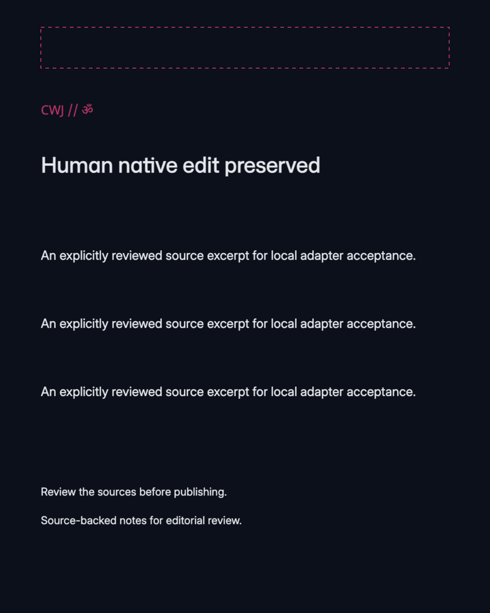
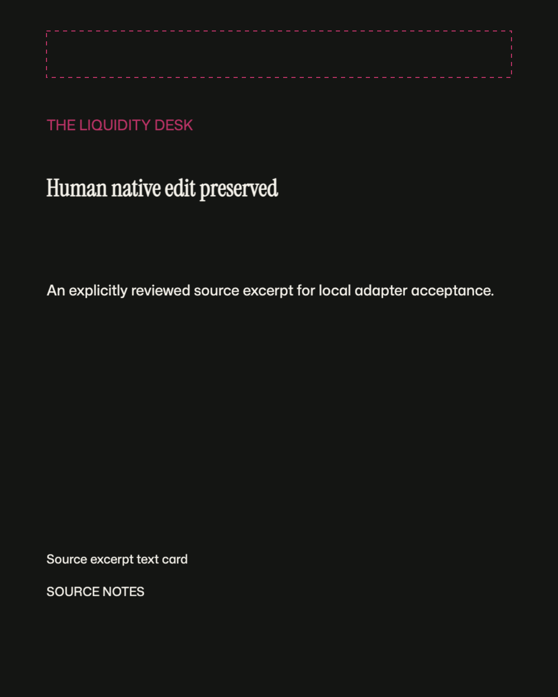
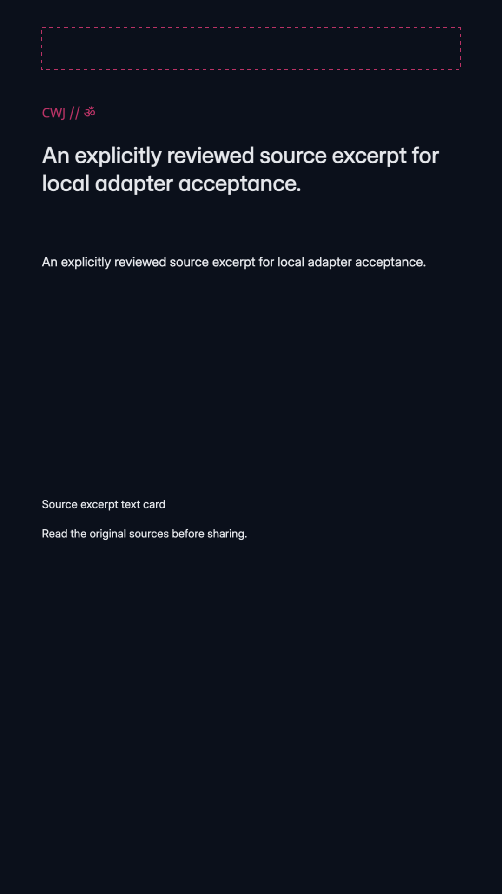

# Doory static export matrix: 2026-10-18

The operator used the actual authenticated Doory browser File → Download → PNG at 1×, selecting all pages, on all eight controlled native documents from the [explicit-glyph API experiment](../53-doory-native-verified-glyph-api-evidence.json). Carousel and reel-board downloads were ZIP archives. This records static PNG export across both presets and all four formats; it does not establish video, cutout execution or a portable native asset archive.

Upstream Doory is pinned to `27b6f68221fdbf1ef1bedc182e303210ca9e39f5`; Studio adapter source is merged `f0e7fb5`. The local QA session loaded the registered licensed fonts through the bounded font whitelist described in the [adapter contract](../../specs/doory-native-adapter.md). Fonts working in this session do not establish cross-machine portability or protected production asset delivery.

## Verified matrix

| Preset | Format | PNG pages | Dimensions per page |
| --- | --- | --- | --- |
| The Liquidity Desk | Infographic | 1 | 1080×1350 |
| The Liquidity Desk | Carousel | 4 | 1080×1350 |
| The Liquidity Desk | Story | 1 | 1080×1920 |
| The Liquidity Desk | Reel storyboard | 3 | 1080×1920 |
| Chai With Jai | Infographic | 1 | 1080×1350 |
| Chai With Jai | Carousel | 4 | 1080×1350 |
| Chai With Jai | Story | 1 | 1080×1920 |
| Chai With Jai | Reel storyboard | 3 | 1080×1920 |

The [sanitized manifest](manifest.json) inventories 18 PNG pages with original download/archive entry name, page number, byte size, SHA256 and dimensions. The operator unpacked bounded known entries and decoded every page with PIL. A separate read-only check verified all 18 original signatures, dimensions, sizes, hashes, chunk CRCs and decompressed raster lengths. Identical hashes for carousel pages 2/3 reflect repeated controlled source text; they are retained as recorded, not replaced with invented variation.

Four pages were visually inspected by the operator: CWJ infographic, finance carousel page 1, CWJ story and CWJ reel board 3. That is not a visual fidelity review of all 18 pages. Three unchanged representative PNGs are published below; the remaining 15 are inventoried by hash without publishing their image bytes. The source fixtures include deliberate native heading and token changes performed by the API reproducer before browser export. This matrix does not add manual browser editing evidence beyond the earlier separately recorded native edit experiment.

## Original representative exports

These are original downloaded page bytes, without cropping, resizing, annotation or rerendering. The three representatives were also independently viewed before publication. They contain controlled test copy, explicit missing-subject rectangles and no private identities or credentials.

### CWJ infographic

Preserves the intentional native heading edit, Sanskrit Om, three metric rows, supplemental copy and explicit missing-subject rectangle.

### Finance carousel page 1

Preserves the serif heading, bound accent color, source excerpt and editorial notes.

### CWJ reel board 3

A static 1080×1920 board with its source excerpt, B-roll direction and closing CTA. Three exported PNG boards do not prove a 30-second animation, encoded video, audio or runtime timing.

## Remaining boundaries

Native JSON API copying, browser PNG export and asset-complete portable restoration are separate contracts. Source/style edits remain proposals for Studio review; the fixture is not publication approval or verified clinical/financial content. Actual encoded media, background removal, all-page visual layout assessment, hosted Google-to-editor identity, protected production asset delivery and upstream UI/AAL/commercial licensing remain open. Issues #39 and #53 remain open. This documentation does not modify Studio runtime images, local services or cloud traffic. Earlier native/API/browser evidence is preserved.
