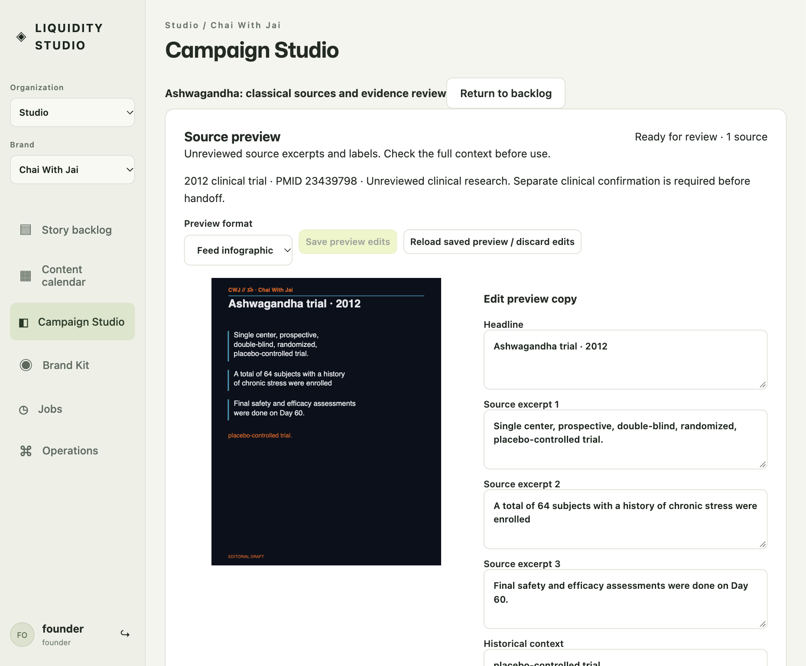
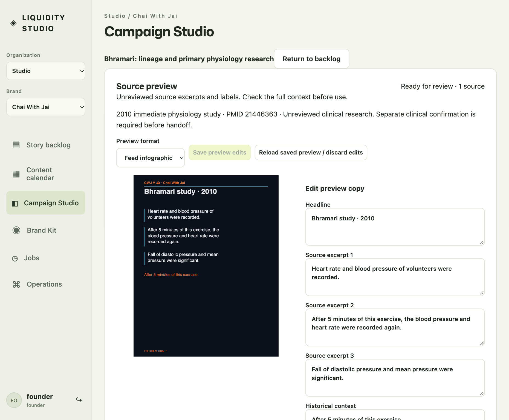

# Clinical source preview acceptance

On October 18, 2026, three clinical source preparations completed through the official worker and NCBI EFetch. Each saved preview edit survived a full browser reload. This was a controlled password fixture. It was not maintained Google-runtime acceptance, clinical review or permission to publish.

The tested source was `4659423e9ebb9dbe73c1e80472823d2284c3e006`, merged through [PR 179](https://github.com/ChaiWithJai/liquidity-studio/pull/179) as `0ea0a916fe20dc6367840cbdc9af76511a1a85f6`. All five [hosted checks](https://github.com/ChaiWithJai/liquidity-studio/actions/runs/39125310390) passed. The [actual acceptance checkpoint](https://github.com/ChaiWithJai/liquidity-studio/pull/179#issuecomment-6249767817) and [sanitized evidence manifest](evidence.json) record the scope and hashes.

## Observed results

| Primary record | Raw XML bytes | Saved preview label |
| --- | ---: | --- |
| [2012 trial, PMID 23439798](https://pubmed.ncbi.nlm.nih.gov/23439798/) | 10,141 | Ashwagandha trial · 2012 |
| [2010 physiology study, PMID 21446363](https://pubmed.ncbi.nlm.nih.gov/21446363/) | 4,516 | Bhramari study · 2010 |
| [2015 reading comparison, PMID 25535358](https://pubmed.ncbi.nlm.nih.gov/25535358/) | 23,335 | Evening reading · 2015 |

Ordinary Neo actions queued one new job per source, opened the preview, saved a neutral label edit and reopened it after a full browser reload. All three candidates retained revision 2. Each displayed the dated publisher, clinical quarantine and expandable full evidence. The main link remained the canonical PubMed citation. Evidence details also showed the actual single-PMID EFetch request and extraction version.

The operator inspected 27 displayed pages through the normal format controls. Each candidate had one feed preview, four carousel pages, one Story and three Reel boards. Feed and carousel pages were 1080×1350; Story and Reel boards were 1080×1920. Every image loaded and no preview layout error appeared. The queued notice cleared. The three screenshots below show the saved feed previews. This does not claim a pixel audit of every page or a native/video export.

Every candidate remained `kind: clinical` and `editorialStatus: unreviewed`. All excerpt statuses remained `unreviewed`, all `clinicalReview` values remained null, and `hasCampaign` remained false. The operator did not confirm clinical review or promote a campaign. A separate reviewer inspected the saved Ashwagandha preview and full evidence through ordinary UI and read-only API. That reviewer also viewed the original Bhramari and reading screenshots and the result report.

## Preserved failures and operational bounds

The three earlier HTML preparations failed with public 502. Only one later Ashwagandha diagnostic Retry measured upstream 203 with encoding absent. The other two upstream statuses and all response-body causes were unobserved. Those failures remain retained. EFetch used new fingerprints and three new jobs, each completed on its first attempt. Four previous reservations plus three new reservations totaled seven under unchanged daily caps of 10 per organization and 20 globally. No quota reset, automatic retry, model call or paid provider call occurred.

The owned app and worker stopped normally after 446.27 seconds. The largest RSS sample was 101,280 KiB, sampled every 5 seconds. This is not a continuously measured peak or a performance benchmark. The V8 old-space setting was 256 MiB; the separate RSS stop threshold was 512 MiB and the deadline was 20 minutes.

Two private backups were retained. The consistent online SQLite snapshot was 81,920 bytes and was captured while the worker was still polling. The exact quiescent copy was 135,168 bytes and was taken after process exit. Both reported integrity ok. Their separate hashes are in the manifest. They are different artifacts; no equality or timestamp normalization is claimed. No database bytes, credentials or session keys are published. The fixture port was released and its Neo tab blanked.

[Issue 162](https://github.com/ChaiWithJai/liquidity-studio/issues/162) remains open for guarded maintained seed follow-through. This evidence records functional retrieval and editable previews, not approval of clinical claims.

## Original Neo screenshots

The browser viewport was 1051×868 CSS pixels at DPR 2. Neo produced 1860×1536 PNG captures. These are original captures with no image editing; screenshot hashes are in the manifest.

