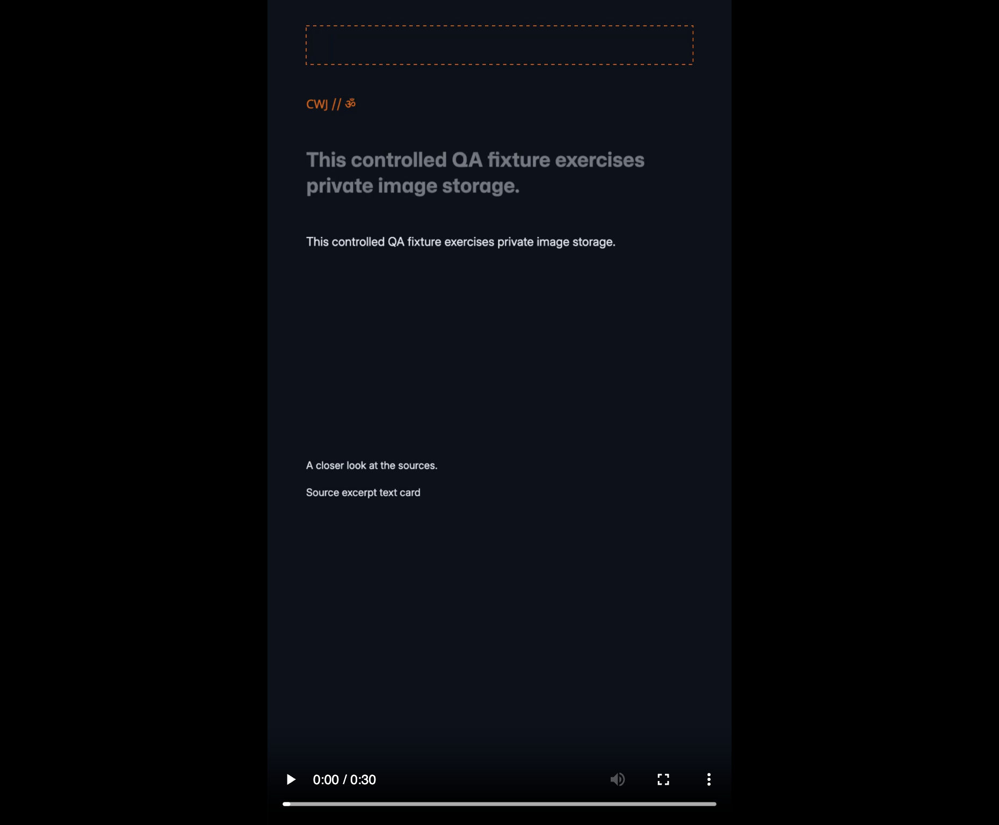
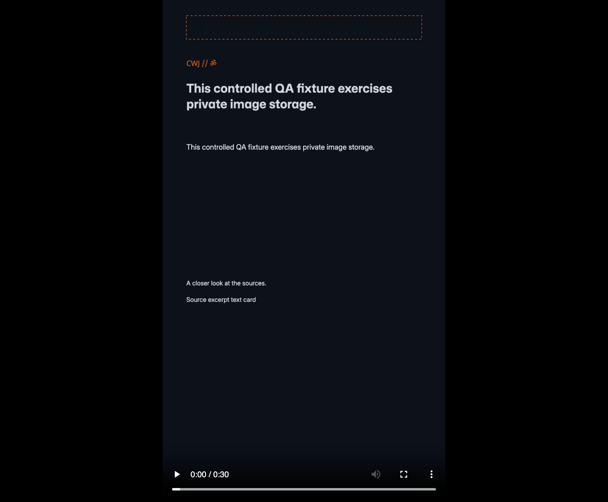
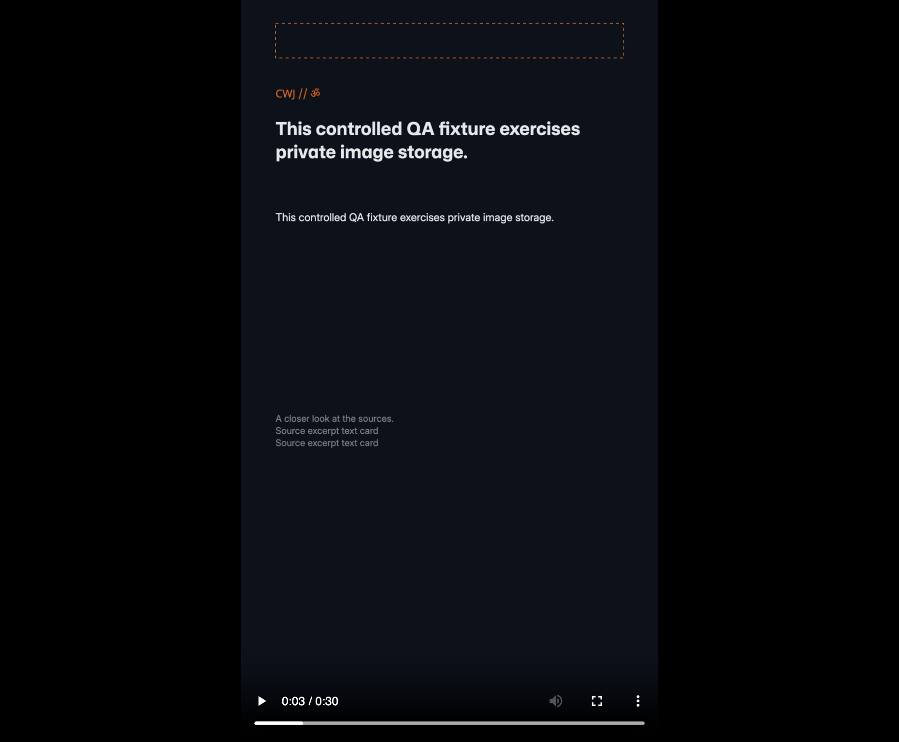

# Native motion export observed in Neo

2026-10-18, issue [55](https://github.com/ChaiWithJai/liquidity-studio/issues/55). Both controlled brand proposals now have actual nonstatic 30-second MP4 and WebM exports through the existing native editor UI. This checkpoint uses a disposable password fixture, not maintained Google acceptance. No audio implementation, paid provider call, new cutout inference, schema change or cloud resource was involved.

## Existing controls and exact timing

In each three-page Reel, the operator selected the first headline in Layers, opened Animate and chose whole-object **Enter → Rise**, duration 1 second and delay 0. Existing page controls applied **Fade** transitions of 1 second. The page hold values were set to **2, 11 and 14 seconds**. Full application reload and reopening the saved native proposals retained those settings: finance revision 8 and cultural revision 5.

The native exporter adds entrance buildup and incoming transition time to each page's hold. Page 1 therefore takes 1+2=3 seconds, page 2 takes 1+11=12, and page 3 takes 1+14=15: exactly 30 seconds. The first page's transition is ignored. An initial proposal to use half-second fades was corrected after observing that the page-duration UI rounds to whole seconds. No internal-state injection or fractional-control bypass was used.

The operator used actual Menu → Download, All pages, Design 1080×1920, 30 fps and As set on each page. The preview reported a 30-second/900-frame plan. The browser's resulting video element reported **duration 30, videoWidth 1080, videoHeight 1920** for every file. The 900 figure remains a UI plan; this checkpoint does not claim exhaustive decoding of all frames.

| Original downloaded file | Bytes | SHA-256 |
| --- | ---: | --- |
| [Finance MP4](finance-motion.mp4) | 684,811 | `d041df8c3bd700f55b07d4d48c646c488dbf6efe44985beeb9d23f86c83ed7a5` |
| [Finance WebM](finance-motion.webm) | 1,368,415 | `ff56f90bc6126e832a8128604331a89ba80873ca36c85b50d21a602c74e60e3e` |
| [Cultural MP4](cultural-motion.mp4) | 745,641 | `cbcda8f5132b0d10545f43edbd2efb34c58bb0fee8c69233549ee9520fbd77d0` |
| [Cultural WebM](cultural-motion.webm) | 1,341,109 | `f82fedc74e506c09151eb9759530692ba6fadcb26d975c06fb07cef5117c5f1f` |

These are original browser downloads, not rerenders or transcoded substitutes. [manifest.json](manifest.json) records browser metadata, sampled frame hashes, pixel comparisons and provenance.

## Actual intermediate frames

The browser decoded seeks at 0.2, 0.6, 1.2, 2.9, 3.5, 4.1, 14.9, 15.5 and 16.1 seconds. Each frame was sampled onto a 270×480 browser canvas. Hashes and pairwise RMS differences were recorded; pixels with a channel difference of at least 20 were counted separately so the observation is more than unequal file hashes.

For the cultural MP4, 0.2→0.6 seconds changed 3,135 sampled pixels above that threshold, RMS 20.15. The first fade's outgoing endpoint→midpoint changed 540 pixels, RMS 4.33; midpoint→incoming endpoint changed 528, RMS 4.29. Both WebMs and the finance MP4 also showed changes at the sampled entrance and transition intervals. This is bounded sample evidence, not full visual validation of every frame.

The actual downloaded cultural MP4 was opened in Neo's ordinary file player. Screenshots show a faint, lower headline at 0.2 seconds, a brighter raised headline at 0.6, and overlapping outgoing/incoming supporting text at the 3.5-second fade midpoint. The generated fixture text is deliberately repetitive and nonclinical. The visible dashed subject rectangle is an explicit missing-asset placeholder; this motion export does not claim a composed portrait cutout.

Screenshots are raw BrowserOS viewport captures and may be scaled by its capture tool. No screenshot pixels were edited.

## Stale private artifact and existing fixes

The first finance MP4 completed successfully using the older private frame, but clicking Change settings then produced **Not available right now**. Read-only inspection of that compiled private artifact found the old `VideoResult` effect returning `scrollIntoView`'s API result, despite the existing [78 cleanup fix](https://github.com/ChaiWithJai/liquidity-studio/pull/78). The same artifact also lacked the existing [83 WebM duration correction](https://github.com/ChaiWithJai/liquidity-studio/pull/83).

One new private artifact was assembled from Studio `4d1e30ee4d1690999337ed83d165d71b90abe23d` and pinned upstream `27b6f68221fdbf1ef1bedc182e303210ca9e39f5`, with **both already reviewed fixes** applied as exact hash-guarded transforms. All pristine upstream inventory, license and token checks remained active without exceptions. The emitted frame HTML SHA-256 is `62c944c28f081841149ed0ccd157f52f49f76f98b6b57290c22c789855df45d3`; license SHA-256 remains `677bf90df999ef9e3a7665ae146547ecb2af491b30b40c65cbf75786c7ee559d`. This is explicitly **4d1 plus 78/83 private overlays**, not unmodified 4d1. No held source, compiled vendor bundle or model weights are published here.

The first assembly failed on a `/tmp` versus `/private/tmp` build-root mismatch. That failure receipt and the original artifact were preserved. A reviewed realpath-only correction produced the new artifact in 6.73 seconds, maximum resident set 900,661,248 bytes, no swaps, with the same 768 MiB JavaScript heap limit. No dependency install, local test runner or heap increase occurred. These are build measurements, not export latency.

Using the new artifact, finance WebM and both cultural formats completed. Actual Change settings unmounted the result successfully for both brands; finance also closed and reopened the Download panel without the earlier error. Both WebMs reported exactly 30 seconds. Native proposals remained unapproved; no verified PNG signoff, social publication or inherited review authority is claimed by these local draft media downloads.

## Timing, backup and remaining boundaries

Recorded UI-start→ready-observation upper bounds were 11.078 seconds for finance WebM, 6.593 for cultural MP4 and 11.257 for cultural WebM. They include tool/scheduling delay and are not precise encoder measurements. The first finance MP4 and total operator interaction time were not timed. The earlier targets of export under 1.5 seconds and operator work under 60 seconds are **not established** by this journey.

The final consistent inline-asset SQLite backup was 745,472 bytes, SHA-256 `b435f3604d08f52e6822b6a55c1aa3977f1318bbb815110dcdba25a6b9687ae0`, integrity `ok`, 40 records. Originals, prior snapshots and the older private artifact remain retained. The worker/frame was unmounted and the heavy-work slot released after exports.

The exporter labels these designs as having no sound. There was no independent audio-stream inspection, audible-output proof, sound-rights approval or audio Phase 2 implementation. This observation establishes existing object motion and page transitions with sampled output; it does not complete whole issue 55, general portrait quality, portable motion round trips, collaboration, maximum-size memory safety or upstream commercial distribution clearance. Fresh cutout lineage and durable recovery are documented separately in the [cutout recovery checkpoint](../fresh-cutout-recovery/README.md).
