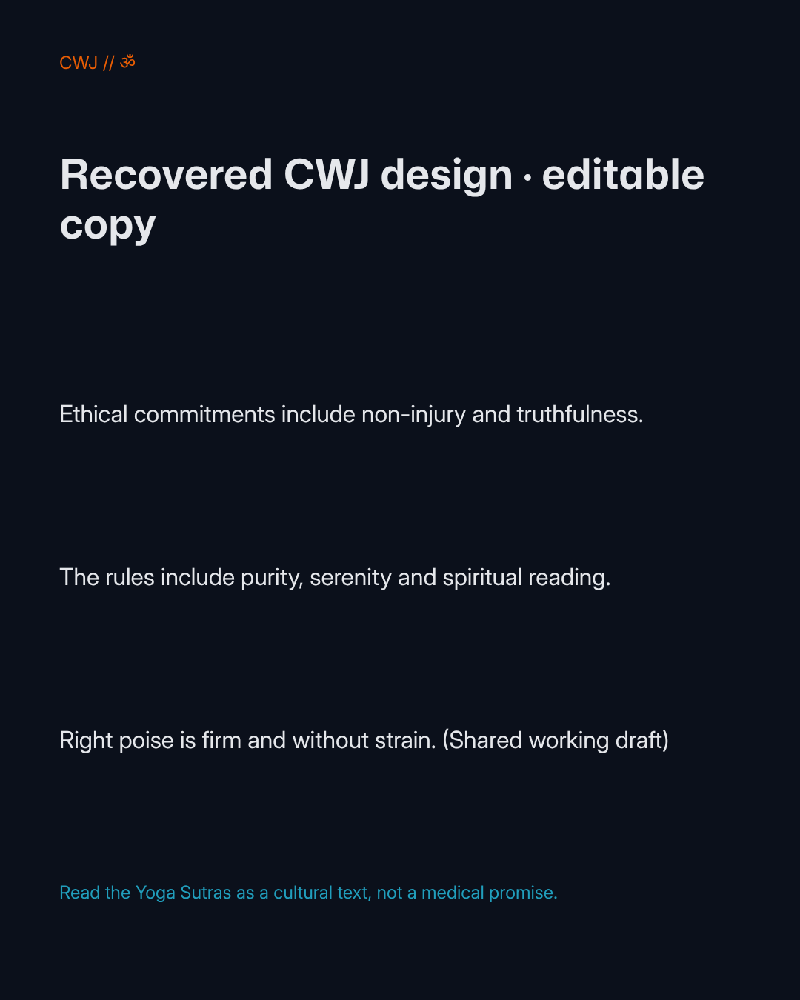

# Whole-instance native recovery, October 18

A controlled local disaster-recovery window restored the existing PostgreSQL15.19 database, all native assets and a complete isolated Studio SQLite snapshot into new local volumes/state. The original native frontend/backend/exporter, Studio and fixed-purpose adapter were gracefully stopped during same-endpoint takeover. Original PostgreSQL, Valkey, containers, volumes and configuration were preserved. Other applications and the earlier separate Studio-pack recovery instance were left untouched.

This is **operator whole-instance recovery**, not a scoped customer export, a parallel multi-instance deployment or a cloud rollout. The full Studio snapshot retained identities, sessions, native pairings/bindings and current policy records. A private copy of its profile marker changed only the database path. The clone adapter targeted the isolated Studio snapshot while the restored native frontend temporarily used the original endpoint. No account, SSO or source-approval claim was invented.

The existing cached native candidate from run39153128667/source `923b0e5c7eeda722b539191a8d8fa6eb304753bd` was reused without a pull or build. Private, consistent backups contained a10,366,976-byte Studio SQLite snapshot,677,540-byte PostgreSQL custom dump and27,107,840-byte native assets tar. Their SHA-256 identities are in the [sanitized receipt](receipt.json). Raw database, archives, private configuration, credentials, session/profile identifiers and runtime environment remain private.

## Actual restored editing and export

Root used ordinary BrowserOS neo UI against the restored services, opened the existing CWJ native design, changed its headline to **“Recovered CWJ design · editable copy”**, saved, and fully reloaded it. The edited headline remained. All26 native file IDs were retained, and only the chosen clone file changed. All260 restored asset files matched the backup byte hashes.

Ordinary native Export→PNG→1× produced76,530bytes at1080×1350, SHA-256 `83e158e1913ec122639085143418d4dc3c95ffdd2aece9239198fe29876fb4c3`. Root viewed the actual PNG in Neo and observed the new headline, Om glyph and expected typography. The committed output was independently hashed against that receipt; the retained row snapshots independently show26 matching IDs and exactly one changed clone file. This is an actual editing/rendering observation, not an inference from backup counts.

## Restoration of the original services

The controller ended normally with exit0 and its retained journal recorded `restored:true`. Clone writers were stopped before the original native frontend/backend/exporter, Studio and adapter restarted. The original PostgreSQL and Valkey had remained running. Root compared all26 original file records' revision/timestamp/data-MD5 metadata with the pre-window snapshot and found exact equality, then reopened the original through Neo and saw its original headline intact. No source database restore, source-volume replacement, broad cleanup or pruning occurred.

The private maintenance packet and source/clone snapshots remain at `/tmp/liquidity-penpot-dr-takeover`; no raw state from it is published here. No local test runner, model inference, dependency install or build ran for this acceptance. Root performed the browser and maintenance execution; this documentation adds source-only receipt reconciliation.

## Remaining scope

Issue57 stays open. This adds native whole-instance recovery beside the earlier [separate application-pack installation proof](../fresh-install-recovery-neo.md). It does not establish a managed cloud deployment, monthly budget, fresh AMD64 runtime, automatic customer-scoped native restoration or concurrent live-instance behavior. The already accepted original Instagram24-item product audit remains separate; it was not repeated or relabelled by this recovery journey.
