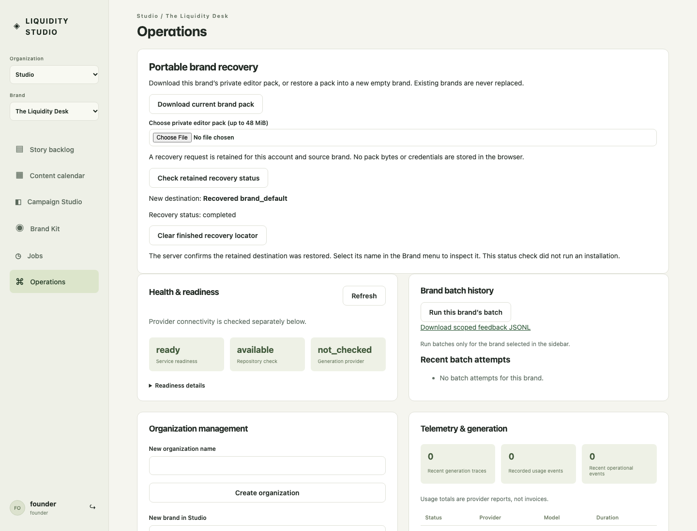
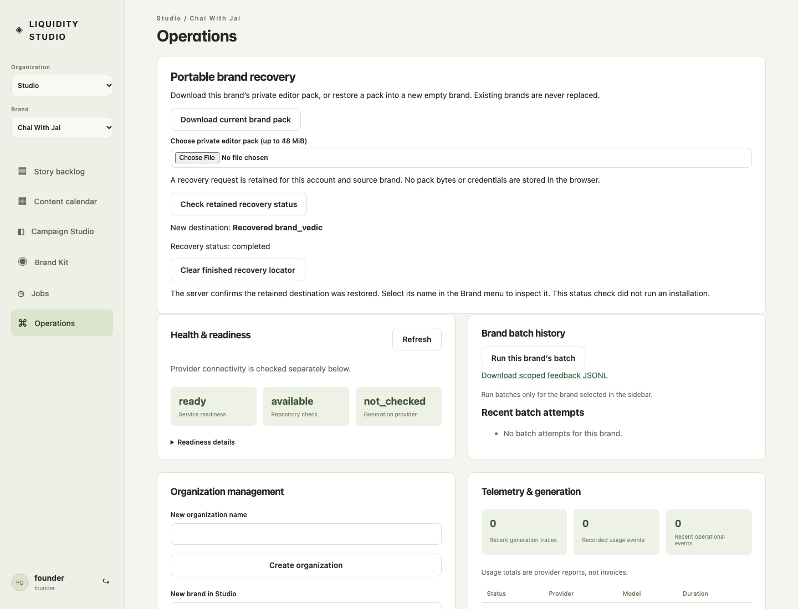

# Founder portable recovery acceptance

The Operations panel uses the existing portable-pack service and ordinary scoped identity dispatcher. It is available only under both existing native and portable feature flags; neither flag was enabled on a maintained runtime in this slice.

Five actual built-App Chromium journeys passed against owned disposable SQLite databases: finance and cultural brand downloads/restoration into a new empty brand, completed-journal rejoin after reload, lost destination/install replies with identical request keys across reload, marketer denial, and a controlled interrupted installation fixture followed by real status/rollback/reinstall endpoints. The interruption fixture represents a persisted crash checkpoint; it is not a new killed-process test. Existing portable-core process-crash tests remain separate evidence. The downloaded JSON packs were private test outputs and are not committed.

The status endpoint also passes a real held-HTTP-body check: it remains available while another portable request occupies admission. It constructs no repository and changes no reserved source state. Focused server tests verify original-actor-only replay keys, denial after membership removal, no private journal data, destination duplicate-key concurrency, payload conflict, capacity refusal and retained receipts after later destination edits.

The complete combined Node result and exact screenshot/source fingerprints are recorded with the versioned evidence. No managed Google login, cloud restore, model call, held vendor distribution, maximum-size memory benchmark or native-layout rebind follows from these checks. Imported prepared-copy and native approvals remain historical. The human source reattestation and native rebind continuations retain their own contracts.

See [manifest](operator-recovery/v1/manifest.json) and [portable-pack specification](../specs/editor-portable-pack.md#founder-operations-recovery-workflow).
