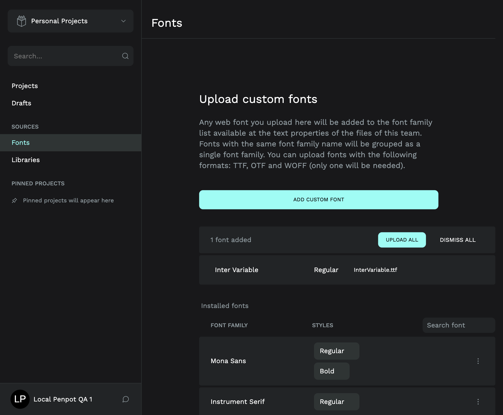
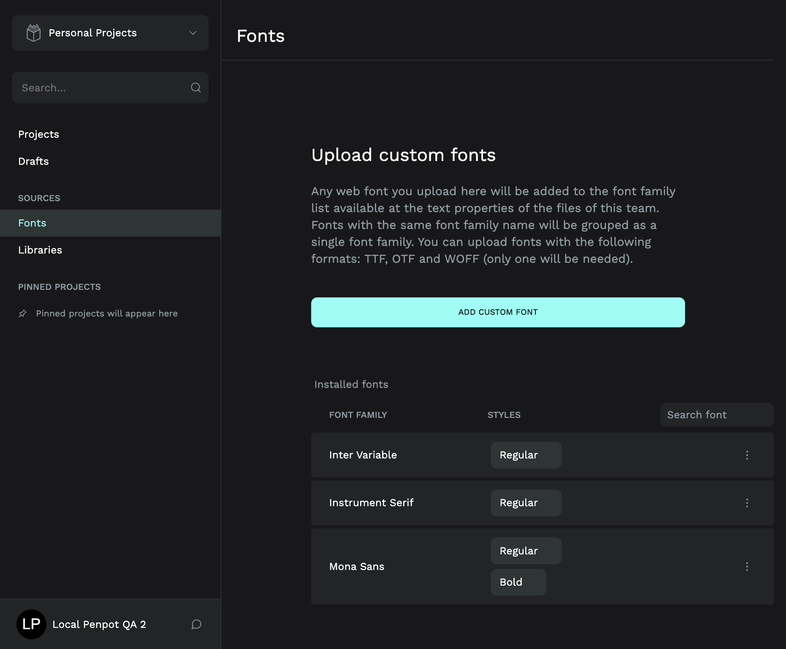

# Inter normal native Font UI checkpoint

On 2026-10-18, a reviewed Penpot 2.18.3 frontend derivative compiled successfully and accepted the existing InterVariable.ttf through the normal native Font UI in a disposable local fixture. The installed font survived a full browser reload. The original stored TTF matches the879708-byte source exactly. At this initial upload checkpoint, the cultural layout had not yet been rebound. The later [fresh-owner cultural recovery proof](cultural-recovery/README.md) now records the intended Inter rendering and exact PNG result, with the separate Om system-fallback limitation. Issues 54 and 57 retain their broader recovery requirements.

This is a later runtime checkpoint. Earlier source-only recipes and failed build records describe their actual earlier stages; this result does not rewrite them. The temporary candidate frontend has been removed and the original frontend restored. No maintained Studio, cloud deployment, Google identity, native source document or original font was changed.

## Source and hosted build

The target is [upstream ff7a66f](https://github.com/penpot/penpot/tree/ff7a66f51938b2293260ea27a64e2c4e0833b5e3), application/protocol version 2.18.3. The [original-owned patch/build recipe](https://github.com/ChaiWithJai/liquidity-studio/tree/c8307769e7916180a9cbed0a04599c75b4dea2aa/scripts/investigations/penpot-font-ui-repair) changes font-name lookup per requested name and guards missing metadata. It does not override the parser globally, convert or substitute the source font, or bypass the native upload API. Upstream source remains under its [MPL 2.0 license](https://github.com/penpot/penpot/blob/ff7a66f51938b2293260ea27a64e2c4e0833b5e3/LICENSE); patch/source notices and the complete upstream source archive accompany the candidate artifact. The input font retains its existing OFL notice; this is not a general licensing assessment.

[Hosted run 39120379123](https://github.com/ChaiWithJai/liquidity-studio/actions/runs/39120379123) on head c830776 passed the actual official full frontend build. Exact pnpm 12.5.1 package/native SRI, executable-byte and frozen-lock checks passed first. The retained complete candidate graph has 900 files / 251827069 bytes, all path/size/SHA verified against its manifest. The artifact ZIP is 336114582 bytes/SHA256`48e6616349c1f654dbe567d0ca47e6fb77a975395cca8cb1d05851adbaed4885`; its candidate TAR SHA is`2f2d5852d076a8fe5a6e642b2ff97931b2254f17042aaf140eb2278659e47f52`.

Four earlier setup failures and one cancelled old-head dispatch remain preserved: [39118020071](https://github.com/ChaiWithJai/liquidity-studio/actions/runs/39118020071), [39118630705](https://github.com/ChaiWithJai/liquidity-studio/actions/runs/39118630705), [39119145688](https://github.com/ChaiWithJai/liquidity-studio/actions/runs/39119145688), [39119793724](https://github.com/ChaiWithJai/liquidity-studio/actions/runs/39119793724), and [cancelled 39119730562](https://github.com/ChaiWithJai/liquidity-studio/actions/runs/39119730562). They stopped before frontend compilation. Actual diagnostics identified an official global shell launcher distinct from the installed native executable; verification was corrected to select the unique owned native binary with the same pinned hash, not relaxed.

## Normal BrowserOS Neo flow

Root operated one owned Neo page with page-local cache disabled and verified the served candidate dashboard/shared hashes before selecting a font. With normal QA1 login, one selection of the original file produced “Inter Variable / Regular,” the correct filename and enabled Upload. No re-seq error appeared. That pending selection was dismissed without uploading. Root then used normal QA2 login and clicked Upload once. Installed Fonts showed the new family, and a full reload retained it with no pending upload. The family was not renamed to “Inter.” No direct API font write, custom token or account simulation was used.

The input file's host SHA was checked before selection. The native handler cleared its file input; **no new internal browser FileReader hash instrumentation is claimed**. The independently verified persisted original TTF supplies the subsequent byte identity proof.

The screenshots show only disposable fixture labels, not personal identities or credentials. Their original bytes and SHA values are recorded in [evidence.json](evidence.json).

## Independent persistence and preservation

Read-only native metadata found exactly one new QA2 variant: Inter Variable, weight 400, normal. The previous Instrument Serif and Mona Sans regular/bold variant rows were unchanged. Actual persisted native storage bytes were independently hashed:

| Format | Bytes | SHA256 |
| --- | ---: | --- |
| Original TTF |879708|`4989b125924991b90d05b2d16e0e388c48f7d5bb8b30539bbf9c755278d0ccaf`|
| Generated OTF |598868|`c5a0ea9a80dc5f8181feeaca5828e86b21c55da82f4b18f63eec3c62ff5d36d7`|
| Generated WOFF |432716|`953d38e4d38f94f97a35ef6879672c4b4e768db46d463bcb1c70210f68e15ce5`|

No WOFF2 object was generated. The four source/restored native document revisions 17/9/18/9 and stored data fingerprints remained unchanged. No typography mapping, document content, geometry, token, media or page-order edit occurred. Storage reads do not establish asset-delivery privacy or issue52 identity enforcement.

## Controlled activation and restoration

The candidate omitted three image/runtime-created files: LICENSE, version.txt and js/config.js. The actual running baseline was independently hashed:876 files already matched the candidate; all 24 modified files matched the recorded original. All 24 changed paths were mounted read-only, with `create_host_path:false`, as the complete inventory-derived delta. The original entrypoint, image, UID 1001, environment values, resources, network and loopback port remained unchanged. The actual generated324-byte config was preserved, rather than the image's77-byte default. All 900 candidate bytes and the three preserved files passed post-mount checks.

Two metadata guard failures caused immediate baseline rollbacks before the final successful activation. The first compared generated Docker hostnames and environment-array ordering too strictly. The second compared authored host paths lexically with Docker Desktop's mapped paths. They were not startup, permission or candidate-byte failures: all900 byte checks had passed. Corrections accepted only generated hostnames tied to their own container IDs, identical duplicate-free environment key/value maps, exact reviewed Compose hashes and provenance, and the exact authored-or-Desktop-mapped source set. Other functional configuration remained strict. Failed metadata checkpoints remain recorded separately; a generic inspect snapshot was later reused, so no separate raw failed snapshot is claimed beyond the retained tool/independent review record.

A consistent 525977-byte native backup was validated before activation. After UI persistence proof, the owned frontend alone was restored to baseline. All 900 original hashes and three runtime files matched, other containers and all four document fingerprints were unchanged, and root independently confirmed the original dashboard asset through Neo. QA1 was restored through normal login, and the page's cache setting was restored. The new QA2 variant remains installed. No callback, ingress or maintained-runtime change was made.

The separately guarded cultural-copy font binding and glyph/export result is recorded in the [later recovery checkpoint](cultural-recovery/README.md). The upload checkpoint alone did not establish that result, and neither checkpoint establishes fresh-installation recovery.

After baseline restoration, the generated 251827069-byte graph directory was removed only after all 900 file hashes and 44 directory entries were checked and no running container mounted it. The verified ZIP and small source/license/manifest/evidence files remain recoverable. This was targeted fixture cleanup, with no Docker prune or unrelated deletion.
