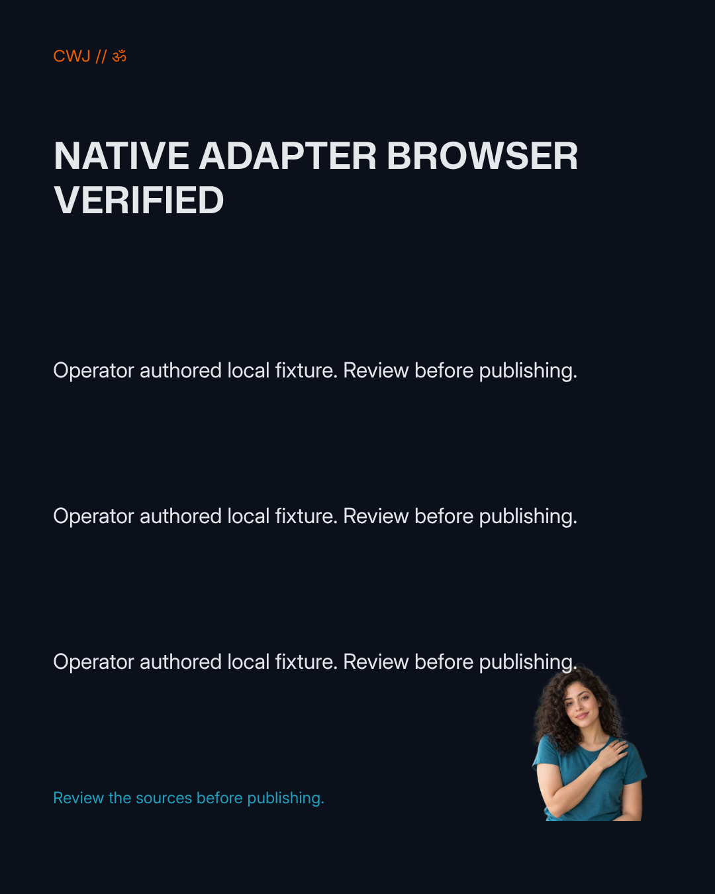

# Cultural fresh-owner font recovery

On 2026-10-18, the restored cultural file rendered with the fresh owner's installed Inter Variable and Mona Sans fonts in the original Penpot 2.18.3 frontend. One normal native PNG export reproduced the earlier original output exactly: **138103 bytes, 1080 × 1350, SHA256 `87257a42a362e184dcc9e703101ddfb1825dbd54ef315a8bc80963d7739d4c49`**. The headline, three body lines, footer and controlled fictional portrait are visible. Root independently inspected the actual PNG and native snapshots. No aesthetic or real-person quality assessment is claimed.

The full sanitized counts and hashes are in [evidence.json](evidence.json). Credentials, session cookies, raw native files, upstream bundles and font binaries are excluded.

## Native binding and reflow

The target was the disposable QA2 copy imported from the existing native archive into its own team, on the same server. The registered Inter Variable font retained the exact reviewed 879708-byte TTF, SHA256 `4989b125924991b90d05b2d16e0e388c48f7d5bb8b30539bbf9c755278d0ccaf`. Its family was not renamed, and the text's existing `fontFamily: Inter` label was retained. The pinned [native text style resolver](https://github.com/penpot/penpot/blob/ff7a66f51938b2293260ea27a64e2c4e0833b5e3/frontend/src/app/main/ui/shapes/text/styles.cljs) selects the registered family through `fontId`.

After a fresh consistent native backup and current profile/team/project/edit checks, one official typed `update-file` request advanced the copy from revision 9 to 10. It changed exactly 100 fontId scalar positions across 50 native text shapes: 82 Inter regular references and 18 Mona Sans bold references. Nine owned component timestamps also changed. The strict fontId-only audit therefore remained false; the separately qualified audit accepted those exact nine native timestamp effects and found no other data changes. Original files and the already restored finance copy remained unchanged.

Ordinary visits to all nine pages refreshed eight pages, but the first infographic retained cached `positionData.fontFamily: Inter`, visibly producing fallback text. An ordinary full reload did not fix it. That failed passive-refresh checkpoint is preserved rather than described as successful rendering.

The authorized native remedy selected each of the first frame's five Inter text shapes, pressed Enter to enter text editing, waited for the registered fonts, then pressed Escape without character input or style changes. Penpot updated five cached font-family values and added five internal rich-content child keys, with one owned component timestamp. Independent comparison found deep equality after removing exactly those new keys and reversing only the observed cache values and timestamp. These native normalization effects are separate from the original 100-ID remap proof.

The completed native readback was revision 14: nine pages, 50 text shapes, 41 Inter Variable cached text runs and 13 Mona Sans runs, including wrapped lines. Text, font IDs, object geometry, tokens, media and page order remained unchanged through the reflow. No programmatic positionData or geometry was written.

## Actual output and glyph boundary

The normal Design panel's existing PNG 1x export was used once on the first frame. Exporter logs identified the restored copy, its current first page and frame. The original exporter had no derivative mount. No callback, private ingress, asset bypass or new font upload was used during this window. The downloaded PNG is byte-identical to the earlier original cultural PNG; it is a fresh export of the restored copy, not a reused download presented as a new render.

The Om character is visible without tofu in the PNG, but this is **not portable Om font coverage**. Inspection of every Unicode cmap in the four reviewed source fonts found glyph zero for U+0950. On the actual Neo editor text `CWJ // ॐ`, CDP `CSS.getPlatformFontsForNode` reported seven custom Inter Variable glyphs and one system Kohinoor Devanagari glyph. The PNG's rendering font for that glyph was not instrumented; its visibility cannot establish an embedded glyph font. No substitute font or fabricated glyph was introduced. An explicitly licensed, packaged glyph font remains a separate portability gap under the broader editor recovery work.

## Issue 166 acceptance reconciliation

| Original criterion | Concrete evidence |
| --- | --- |
| Identify the pinned parser metadata assumption | The reviewed per-name English-name fallback patch and actual official hosted frontend build are linked in the [upload checkpoint](../README.md). |
| Preserve original bytes and license | Exact source TTF SHA, persisted original bytes, generated-format identities and existing OFL notice were retained; no conversion or font substitution replaced the input. |
| Reviewed supported upload/recovery path | Normal Neo selection, correct preview, one native Upload and reload persistence passed; the frontend derivative was then removed. |
| Restored cultural layout uses the intended font | Fresh-owner fontId mapping, actual Inter Variable/Mona native caches, qualified no-content-change reflow audit and the first-frame PNG passed. The Om system fallback is explicitly excluded from the Inter coverage claim. |

These observations satisfy the narrow parser/upload and intended Inter recovery criteria of [issue 166](https://github.com/ChaiWithJai/liquidity-studio/issues/166). Root independently inspected the actual PNG and [closed issue 166 with qualified acceptance](https://github.com/ChaiWithJai/liquidity-studio/issues/166#issuecomment-6249557063). They do not establish completion of [issue 54](https://github.com/ChaiWithJai/liquidity-studio/issues/54) or [issue 57](https://github.com/ChaiWithJai/liquidity-studio/issues/57): this is same-server fresh-native-owner recovery, not a fresh installation, a complete portable font/glyph package, every-format output acceptance, or Studio/native human identity pairing. Private asset authorization is also a separate boundary.

After the export, read-only database fingerprints confirmed original finance revision 17, original cultural revision 9 and finance copy revision 18 were unchanged. QA2 logged out and QA1 logged in through the normal UI; a fresh native profile read confirmed QA1 and QA2 was no longer visible. The heavy slot was released. Maintained Studio, cloud services and original native files were untouched.
