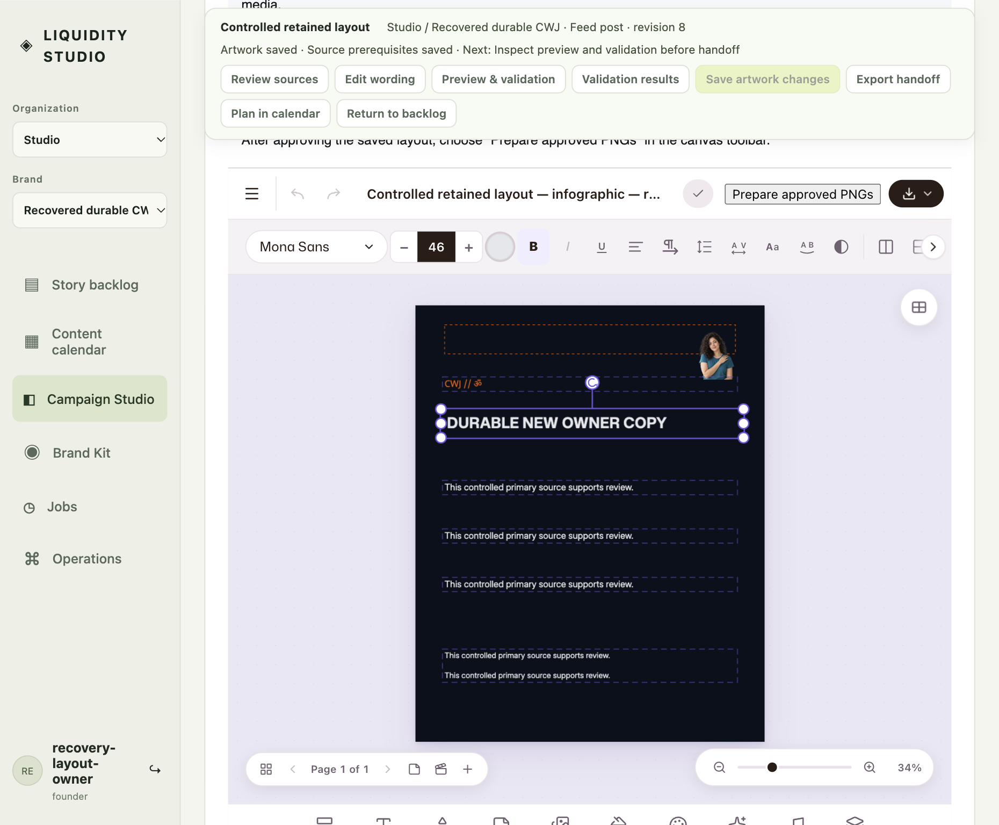

# Durable native recovery checkpoint

Issue [57](https://github.com/ChaiWithJai/liquidity-studio/issues/57), 2026-10-18. This records an actual BrowserOS Neo journey through the Studio application and production service modules using a controlled password fixture. It is not a managed Google login, a cloud migration, or completion of all issue 57 criteria. No local test runner, new inference, vendor build, or cloud resource was used for this checkpoint.

## Observed sequence

1. On the owned SQLite fixture, the operator reviewed the controlled nonclinical source copy, created a new native proposal from its retained human layout, and uploaded the archived original/alpha images through the actual editor file input. The alpha image was positioned on the canvas. These are ordinary owned image assets with a declaration that the portrait is generated and has no actual personal identity.
2. The operator completed the four native review transitions, prepared a real PNG in the EditorApp, inspected it, and explicitly approved and downloaded it. The original 1080×1350 PNG is retained here, rather than rerendered for this report.
3. Operations downloaded a validated version 2 pack: five native layouts, two images and 26 file entries. A consistent SQLite backup was recorded before stopping the source fixture. Both original database files were moved offline and retained as rollback copies; neither was available at its original live path during recovery.
4. A separate fresh SQLite database and a different controlled current principal were used. Operations created a new empty brand and required explicit owner remapping and source acknowledgement before installation. This acknowledgement did not adopt the imported prepared-copy or native approval.
5. The new target process was stopped and restarted. Neo reopened the application against the same target database. The restored completed PNG decoded in the browser as 1080×1350 and its WebCrypto SHA-256 matched the original bytes. The receipt remained historical-only.
6. Opening the historical layout did not enable editing. Attempting continuation before fresh source review was refused. The new owner deliberately forked the retained current campaign, reviewed the 33 copy fields and evidence, and confirmed the current copy. Only then could the operator create a new editable layout proposal.
7. In the actual native canvas, the operator changed the headline to `DURABLE NEW OWNER COPY` and saved revision 2. After a full application reload, selecting that saved layout and opening its editable headline showed the same text and the alpha image. The old revision 4 layout remained historical and unchanged. The new copy still said **Review has not started**; no prior layout approval transferred.
8. The original completed PNG still matched after the new layout edit. Operations successfully downloaded a new version 2 pack. A final consistent, asset-aware SQLite backup included all inline image and PNG bytes, reported integrity `ok`, and retained 30 records. The fixture was then explicitly handed off; no maintained application database was used.

[Original signed-off PNG](original-signed-off.png) and [sanitized measured manifest](manifest.json). The actual browser viewport was 1051×868 at DPR 2; the BrowserOS screenshot capture may scale its output. The copy is a controlled source fixture, not a factual or clinical claim.

## Exact bytes and asset authority

The original PNG is 170,547 bytes, SHA-256 `a9d5cbab74a5a7c63df94b09f045d0358bfeb793c649351cbd5f1953588b0eb6`. The pack before recovery was 3,583,959 bytes, SHA-256 `9c09b90630d3aad4c917539305c92c80a8cb8627378b8b9e6b1f07ba969e46ab`; the re-ejected pack was 3,700,771 bytes, SHA-256 `81d4918c5c881811cb5a8f130b9f583c07c907989f101f261e5a090d17fd7356`. Private packs and database backups are deliberately not published.

Actual scoped asset retrieval after recovery returned the exact 384×384 alpha PNG and original JPEG hashes recorded in the manifest. A document-usage request for the unreferenced original was refused with 422; the original scope was refused with 403; an anonymous request returned 401; a stale native revision returned 409. Refusals returned no base64 payload. Positive delivery used the authenticated current-membership proxy, with no public share.

The alpha and original are the existing [MODNet experiment](../cutout-portrait/native-modnet/README.md) bytes. Native notes retain their hashes, the recorded model hash and an explicit archived-derivation description. This drill did **not** run inference or invent a new worker event, actor or timestamp. The full original native processor record and worker actor were unavailable in this archive; ordinary image preservation plus notes is not proof that those missing records were recovered. Existing inference evidence remains separate.

## Original issue 57 criterion disposition

| Criterion | Evidence or remaining boundary |
| --- | --- |
| Versioned scenes, tokens, fonts, assets, hashes/licenses and historical review | The [pack contract](../../specs/editor-portable-pack.md), implementations in PRs 114/119/124/126/129/133, and this actual version 2 install cover the supported image/native pathway. Exact registered font bytes/licenses are validated by the importer. This journey visually verifies one infographic; the earlier [both-brand/four-format continuation](../native-layout-continuation/README.md) is separate evidence. |
| Cutouts, motion, approvals and feedback | Historical source/layout/review/export evidence is preserved without live authority. This round trip retains an actual archived original/alpha pair, not its missing full native processor record. Timed scene metadata is supported; restored video/audio/motion output and full cutout-lineage completeness remain outstanding. |
| Deletion-independent fresh install and editing/pixel checks | Both source databases were offline, a different owner and new SQLite database installed the pack, the target process restarted, and actual native edit/save/reload plus exact browser-decoded PNG retrieval passed here. Original rollback files were retained, rather than destroyed. |
| Explicit remap, credentials and foreign-reference rejection | Installation here required current owner remapping. Prior scoped HTTP/SQLite negative tests and the pack contract cover missing remap, foreign references and credentials; this checkpoint adds actual contextual asset denials, not a new exhaustive negative suite. |
| Failed migration rollback and interrupted recovery | Prior PR 114/119 tests exercise crash/resume, conditional owned rollback and revocation. This actual successful drill retains verified backup files; it does not claim a new induced disk failure or interrupted browser migration. |
| Database backups, roles/connections and Redis ACL | This pathway uses SQLite plus scoped application authority, not external Postgres/Redis indexes. A consistent SQLite backup including inline assets was taken and integrity checked operationally. External editor Postgres roles, connection recovery and Redis ACL isolation remain unverified if that different stack is chosen. No Firestore replacement occurred. |
| Disk capacity and Docker restart policy | PR 124 incremental archive budgets and PR 126 per-instance admission/body deadline have prior bounded tests. Compose uses `unless-stopped`; this drill proves a bare owned server restart, not Docker Desktop restart, maximum pack heap, or a hard 512MiB capacity guarantee. |
| WebSocket reconnect, revocation and multi-instance recovery | The supported host advertises realtime collaboration unavailable. Page/process reopening here is not WebSocket recovery. Existing authorization negatives do not establish multi-instance recovery or external-room revocation; these remain explicit deployment boundaries. |
| Compose VM versus GCP full forecast and budget | The dated [pilot cost forecast](../57-pilot-cost-forecast.md) includes model, assets, egress, backups and operations assumptions, and separates external SQL/Redis costs. It is a scenario forecast, not a measured invoice or hard $100 cap. No new cloud editor provisioning was performed. |
| Deployment/customer exit and rollback | This is a local durable exit drill with private backups and new-owner review, not a deployed cloud pack restore. Existing upstream binary distribution hold remains. Original databases, maintained Google application and current cloud resources were left intact. |

The retained source-to-copy gates and exact final artifacts now have combined durable browser evidence. Issue 57 stays open for the genuinely outstanding media/lineage, deployment, capacity and recovery requirements above. No claim depends on schemas alone, and this checkpoint transfers no old session, membership, signing key or approval authority.
