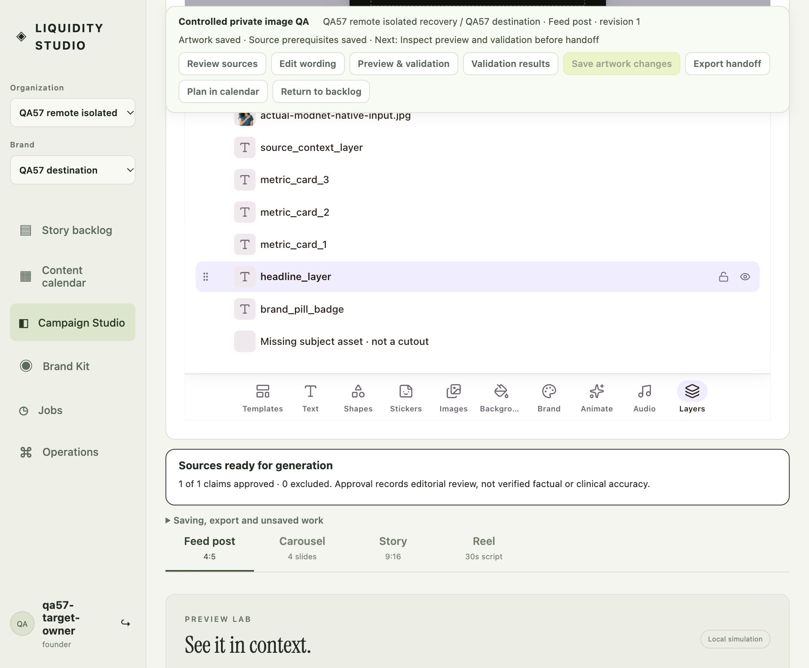
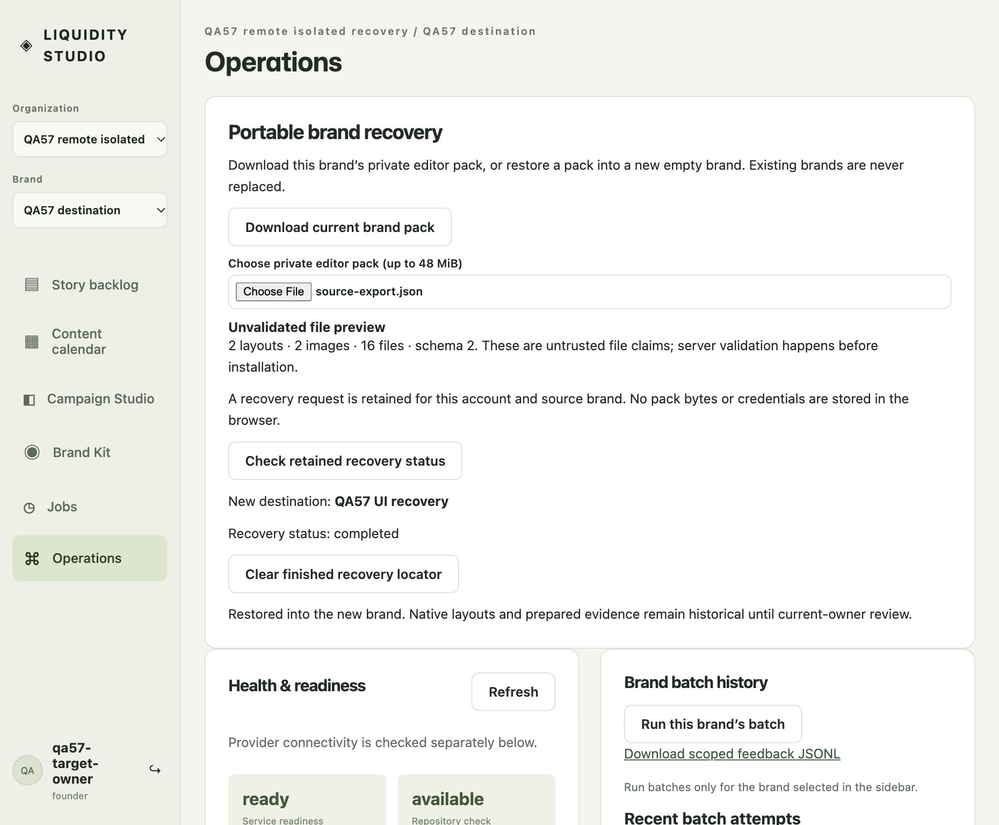

# Bounded Firestore and GCS portable recovery

2026-10-18, [issue 57](https://github.com/ChaiWithJai/liquidity-studio/issues/57). This actual BrowserOS neo observation used a local controlled-password application backed by the existing real Firestore database and private Virginia GCS bucket. It is not a managed Google login, new cloud deployment, multi-instance test or complete editor release. The original application source was frozen at `a65bf3682fa99b26970e5ac1cab144d63f3924d7`; the production `FirestoreStore` implementation was unchanged (SHA-256 `aaaa1597d56bd626dc0046ff542b5228876fb2b31eae94e47f22f0910c48bf8c`).

## Actual sequence

1. After the previous operator released the fixture and its consistent backup was verified, a new isolated QA collection, two fresh founder identities and two predeclared brands were used. The outer operational guard restricted keys/scopes and retained highwater reservations: metadata at most 5 MiB, 64 logical keys and 128 parent/chunk documents; GCS at most 5 MiB and 32 objects globally. No production collection, identity, bucket policy, IAM role or maintained application was changed.
2. The exact corrected combined PR148 pack, 2,852,342 bytes, file SHA-256 `a5fc1f0abee9c5174955a698f88e2eec9e1826e70a0c75b208e6bc02e4f3f4fe`, was installed into the remote source scope through the ordinary service. This operational bootstrap retained the [explicit administrative fixture repair record](../fresh-cutout-recovery/README.md#controlled-fixture-defect-and-explicit-repair); it did not fabricate a new research, generation or cutout event.
3. The first founder signed in through the actual UI and downloaded the source pack through Operations: 2,865,990 bytes, file SHA-256 `72a11c25721a6a0f68882ba8c307efde2721b86dc6c322d2c3445c2888a5990c`. It contained two layouts, two images and sixteen file entries.
4. A different founder signed in and selected that downloaded file. The current panel supports creating a new destination, not selecting a predeclared empty brand. To preserve the exact approved scope allowlist, installation used an ordinary authenticated HTTP request from Neo to the existing install endpoint, with explicit target, owner remap, source acknowledgement and retained idempotency key. It returned 200, two documents, two assets and `reviewAuthority: not-restored`. This was **API installation, not a panel-button installation**; the separate [SQLite recovery journey](../portable-recovery-neo/README.md) already exercises that end-user destination UI.
5. The ordinary status endpoint returned `completed`. Only the owned server was stopped and restarted with the same namespace and exact retained journal. Neo rejoined the same target account, reopened the restored story and loaded its saved native Feed layout. The original source pack remained available as rollback evidence; this round does not claim deliberate remote-source deletion.
6. In the actual native UI, the operator selected `headline_layer` through Layers and changed its font size to 57. Autosave and **Save now** advanced the layout from revision 4 to revision 6. A full application reload, saved-layout selection and actual native reopening showed font size 57 again. Server readback agreed. This is a bounded layout edit, not a new headline-text or factual approval claim. Review still had not started.
7. Neo authenticated asset retrieval decoded both original JPEG and alpha PNG as 384×384 and calculated their exact SHA-256 values using WebCrypto. All twelve historical cutout lineage fields matched the input. The importing owner differs from the original inference actor; execution remains `browser_reported`.
8. The target was re-ejected through the actual Operations download: 2,892,908 bytes, file SHA-256 `73e6a754294850e9e620d46cff04022c200175afec51272e9710ffb75d3d8eac`. Offline comparison confirmed exact original/alpha file hashes and all twelve lineage fields remained unchanged. The owned server was stopped, Neo was navigated to a blank page, and the port/auth slot was explicitly returned.

The screenshot shows the controlled destination and selected native heading layer. The separate ordinary DOM readback records the selected native font size; this screenshot alone is not a measurement of font size or finished layout quality.

## Actual storage and backup

Native image bytes installed inline in Firestore. The subsequent native scene saves used the configured production immutable GCS path and created **two JSON objects totaling 18,124 bytes**. These are distinct observations; inline installation is not described as an image upload to GCS.

The quiescent logical backup retained 25 registered logical records, 52 physical parent/chunk documents and 810,208 bytes of logical JSON, plus both exact GCS payloads. Its private manifest SHA-256 is `b6b29f4f82751483690a8855a9c5b4f8d2aa622c0fb34e0d95b0f5039fe3c0af`. All local logical-record and artifact byte hashes/sizes were independently checked. The manifest preserves exact remote generations and parent/chunk update times for conditional cleanup. This is a quiescent application-level backup, not a database-wide point-in-time backup. Private packs, credentials, raw database/collection/bucket/object locators and backups are excluded here. No remote cleanup had occurred at this checkpoint.

The [sanitized manifest](manifest.json) and [actual asset readback](asset-readback.json) distinguish original action, importing owner and historical restoration provenance. The input JPEG remains SHA-256 `50db12119d03be4f4a2736586210f0eac990a667e7ea0d7a0d5469268dd93c5e`; the alpha remains `be20c97b37e61742d8fb60239df7f13fc3e14385b5b7fdbbb268c9fb228ac31d`.

## Known composition limits and failures

- Generic table requests returned 500 because the private QA wrapper omitted the exact `workspace-views:<organization>:<brand>` namespace used by `WorkspaceViews`. This is an operational wrapper gap, not established production corruption. The later tiny recheck below resolves this private guard omission; the original checkpoint is preserved rather than relabeled.
- The wrapper did not delegate production `checkHealth`, so Operations displayed the fallback `local-database` artifact label despite remote storage. The later tiny recheck delegates the unchanged production check and records the correct remote artifact label.
- Two generic catch-path 503 events were observed without route/reason capture. They are not labeled readiness failures: `/api/ready` returns its response directly, while these events came through the generic error handler. The actual Operations readiness readback was ready/200. Future bounded private status logging is prepared; the precise 503 request remains unestablished here.
- GCS SDK PassThrough `MaxListenersExceededWarning` messages appeared during native payload operations and backup. They were neither suppressed nor fixed. The passing bounded byte operations are not a leak-free, stress, maximum-pack heap or low-disk guarantee.
- An attempted raw native PNG download produced no new file, so no new PNG export artifact is claimed. Browser asset decode, native UI persistence and exact pack bytes are the measured results here. No inference, paid provider call, restored motion/audio, external collaboration, new Google login or distribution clearance was performed.

These observations advance the remote-storage portion of issue 57. Its remaining media, collaboration, capacity and distribution boundaries remain explicit in the [current pack specification](../../specs/editor-portable-pack.md); this report does not close the ticket or authorize additional infrastructure.

## Later full ordinary UI recovery and tiny recheck

The subsequent controlled Neo journey completed the end-user remote destination path as well. It does not convert step 4 above into a UI-button observation; these are distinct checkpoints.

The operator selected the retained source-export pack in Operations, entered **QA57 UI recovery** with the financial preset and clicked **Create new empty recovery brand**. The ordinary endpoint returned 201. A private outer QA guard permitted exactly one extra scope only after validating the production deterministic receipt-key-derived UUID, exact empty preset state, and the sole identity changes adding that brand and the current target founder's membership. The production service and auth rules remained unchanged; there was no browser-supplied wildcard, new organization or budget reset.

The visible exact-pack current-owner remap/nonclinical-source acknowledgement was deliberately checked, then **Restore into this new brand** was clicked. The ordinary install endpoint returned 200. Operations displayed **Recovery status: completed**, while explaining that native layouts and prepared evidence remain historical. After full page reload, **Check retained recovery status** again confirmed completed without reinstalling. Selecting **QA57 UI recovery** in the Brand menu showed the restored controlled story in the actual backlog with no alert. No native frame, model, inference or render ran during this extension.

[The measured UI record](ui-completion.json) retains the explicit 201/200 observations. The final quiescent backup independently confirmed the two asset hashes and all twelve historical cutout-lineage fields in this UI-created scope as well. This stage used a new current owner relative to the remote source; it did not install old principals, sessions or approval authority.

Before the UI extension, a tiny corrected-composition recheck returned 200 for scoped views and the actual backlog query, with six visible rows and no table alert. `/api/ready` returned ready/200 with repository and artifacts both **available**, generation provider **not_checked**. The only guard change for views was exact equality on the permitted `workspace-views:<org>:<brand>` keys; `checkHealth` delegated unchanged production behavior. These fixes were private QA composition corrections, not production service changes.

A safe request to the explicitly disabled `/api/studio/native-editor/cutout/model` returned 503 and was correlated by route/request ID in bounded private status logging. The disabled-model source path fails before model loading/inference. This establishes that specific recheck response; it does not retroactively assign the earlier unclassified 503 events to that route. See [tiny-recheck.json](tiny-recheck.json). SDK listener warnings remained unsuppressed.

## Final quiescent backup and authorized cleanup

The final v3 backup retained 37 registered logical records, 78 physical parent/chunk documents and 1,210,961 bytes of logical JSON, plus the same two immutable GCS scene objects totaling 18,124 bytes. Its private manifest SHA-256 is `75e34ae6a755f614994301c5ed602acd8e0c58bdc846ee0406de587935725bc5`. Every present local record/artifact size and SHA-256 was independently checked before cleanup. V1 and v2 backups, original packs and all local payload bytes remain retained.

After explicit operator review and authorization, the cleanup first compared the exact isolated QA record/chunk inventory, nanosecond update times, canonical parent metadata, chunk bytes and both GCS generation/owner/hash/MIME/CRC records against v3. It then deleted exactly **78 Firestore documents in one all-or-none WriteBatch**, with an exact `lastUpdateTime` precondition on each parent/chunk. Only afterward did unchanged production generation-match deletion remove the **two recorded GCS generations**. Exact recorded locations were verified absent. No recursive deletion, production namespace enumeration, foreign object, IAM or service change occurred.

[The sanitized cleanup receipt](cleanup-receipt.json) records actual outcomes. The fixture was stopped, its Neo page blanked, and the port/password-fixture slot explicitly returned. No application requests followed release. This cleanup is not a provider hard-erasure or retention-expiry guarantee, and it adds no stress, multi-instance, managed Google, media or distribution acceptance claim. The original API-only evidence and unresolved limits above remain accurately bounded.
