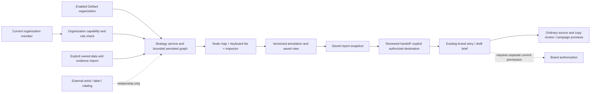

# Defiant: reconciliation and first delivery

Status: implementation brief proposed by #210, 2026-10-18. No Defiant feature is implemented by this change. Read [#209](https://github.com/ChaiWithJai/liquidity-studio/issues/209), its latest direction comment, [#214](https://github.com/ChaiWithJai/liquidity-studio/issues/214), then this brief. #214 makes the node workspace primary; a dashboard is not a substitute. [#211](https://github.com/ChaiWithJai/liquidity-studio/issues/211) delivers the integrated experience; #214 supplies its graph/report acceptance, not a second competing implementation.

The first win: a manager opens a regional cluster, inspects a talent signal and its evidence, follows a route, imports a usable partner/resource, annotates a selection, saves a report, then deliberately creates a campaign preview for an authorized Defiant destination. The map must remain useful when every growth metric is unknown.

Baseline: main `52b610b` (PR213 merge). [Source and seed inventory](evidence.json) records the full SHA and hashes. [Model and representative records](model.md) define the proposed contract; [records.json](records.json) is clearly illustrative, never an import or migration. No application code, accounts, jobs, providers, native files or deployed environments were changed. No local test/build ran; source/seed inspection and current primary-document research are not runtime acceptance.

## What exists and what does not

Search of the baseline tracked tree, all fetched Git refs' history for the claimed paths, and matching branch/worktree names found neither `server/anr-network-engine.js` nor `server/defiant-xxl-seed.js`. No matching Defiant implementation branch or open PR was found during this investigation. This does not establish what an unavailable external prototype did. The supplied comments' 9/9, 5/5, 10/10 and `SEEDED_AND_PASSING` claims are source assertions, not current tests. There is no formula implementation to recover from those paths. No current `defiant_records` preset, Defiant route or source adapter was found.

The actual application already has organization membership, explicit brand authorization, persistent scoped records, guarded jobs, source retrieval, reviewed prepared-copy promotion and campaign previews. Those are reusable foundations, not an existing A&R engine. Instagram chrome is explicitly a simulator; no connected Instagram account/publishing adapter was found. Do not label a brand destination as a verified connected account.

## Reusable source seams

These links pin the inspected baseline rather than implying a proposed route already exists:

| Source | Reuse and limit |
|---|---|
| [Organization/membership authorization](https://github.com/ChaiWithJai/liquidity-studio/blob/52b610b/liquidity-studio/server/auth.js#L149) | Existing membership and brand checks; strategy capability and organization edit policy are new |
| [Brand-required request scope](https://github.com/ChaiWithJai/liquidity-studio/blob/52b610b/liquidity-studio/server/index.js#L837) | Organization strategy routes need their own authenticated scope before this branch |
| [Scoped repository](https://github.com/ChaiWithJai/liquidity-studio/blob/52b610b/liquidity-studio/server/repository.js#L13) | Existing brand persistence/restore guards; not an organization graph store |
| [Transaction limits](https://github.com/ChaiWithJai/liquidity-studio/blob/52b610b/liquidity-studio/server/storage-transaction.js#L5) | Reuse current atomic store and explicit capacity, not a second database |
| [Source retrieval](https://github.com/ChaiWithJai/liquidity-studio/blob/52b610b/liquidity-studio/server/source-retrieval.js#L12) | Bounded allowlisted source fetching; not arbitrary social scouting |
| [Prepared promotion](https://github.com/ChaiWithJai/liquidity-studio/blob/52b610b/liquidity-studio/server/prepared-promotion.js#L298) | Exact review, receipts and copy provenance patterns; not a ready strategy handoff API |
| [Workflow URL state](https://github.com/ChaiWithJai/liquidity-studio/blob/52b610b/liquidity-studio/src/lib/workflow-location.js#L1) | Publishing navigation only; graph focus/view/report routing is new |
| [Campaign simulator](https://github.com/ChaiWithJai/liquidity-studio/blob/52b610b/liquidity-studio/src/Emulator.svelte#L490) | Reusable campaign preview after review, not a live Instagram account |

## Gap map

| Product intent | Current evidence | Difference and proposed treatment | Delivery dependency |
|---|---|---|---|
| Separate label workspace | `IdentityService` organizations, memberships and brand IDs; `ScopedRepository` is brand scoped | Add explicitly enabled organization strategy state and membership check; no Defiant brand preset or reuse of either pilot brand as the organization | D1 |
| Node-first exploration | Existing workflow URL helper recognizes publishing tabs/formats only | Add strategy route with typed nodes/edges, progressive neighborhood expansion, inspector, keyboard list, selection/back and saved view; keep existing publishing routes intact | D1–D2 |
| Raw talent with evidence | Source catalog/retrieval is curated to existing pilot topics; source records retain response/text hashes | Start with explicit manual link + user-supplied excerpt/observation import. Preserve method/time, do not pretend the server retrieved it. API scouting follows actual access/quotas | D1–D2 |
| Velocity over time | Seed contains one set of unsubstantiated numbers per signal | Keep observations separate; derive a delta only from compatible timestamped counters. Seven-day views/replay/acceleration remain unknown without the required history/permission | D2; optional provider later |
| Editable regional routes | Eight illustrative directed corridors, no current service | Version hypotheses and bridge requirements; show path continuity and uncertainty, no calibrated probability or projected listeners by default | D2 |
| Owned network | Nine named connector examples, no proof of ownership/access/rights | Add one small organization import for people/resources/relationships, availability/time zone and rights evidence. Unverified examples cannot become selectable cleared assets | D2 |
| Useful matching | Fixed seed chemistry and multiplier values, missing scoring implementation | Feasibility first, then visible component reasons and deterministic ordering. Missing rights/availability yield needs-information, not a high confidence percentage | D2 |
| Annotation, saved view and report | No graph annotations or report state | Separate source records from authored interpretations; bind reports to immutable source/annotation revisions and snapshot selected findings | D2 |
| Reviewed campaign handoff | Existing prepared promotion requires exact editorial copy/evidence review and source classification | New explicit strategy handoff creates a draft brief in the chosen brand, not `verifiedFacts` or a forged prepared candidate. Reuse campaign editor after ordinary source/copy review | D3 |
| Multiple account destinations | Current brand authorization exists; no actual social-account connector found | Support multiple authorized brand destinations now; optional account label is unverified metadata. Connected-account resolution deferred, never silently inferred | D3 |
| Resume and retry | Current URL state + stored idempotent promotion receipts | Give strategy stable URLs and actor-bound handoff key/payload hash; resume the same intent and return the same story on lost reply | D1–D3 |
| No interference | Brand keys, source catalogs, worker admission are explicit existing boundaries | No startup global seed, changed preset, all-tenant scout or inherited graph permission. Only enabled Defiant organization receives strategy endpoints/nav/state | All |

## Executive architecture

Reuse the existing server, authentication and store. A small organization-scoped strategy service owns a bounded document/read model; it is not a new graph database, identity service or ML stack. Its request boundary must run after authentication but **before** the current brand-required `/api/studio` scope path. New organization authorization must not weaken the existing brand check.

Organization membership gates research; explicit allowed roles/capability gate edits. Founder and marketer are existing roles; do not add an executive hierarchy just to use the seed. A founder enables the capability only on the intended organization. External companies and artists are entity nodes, not application tenants. Restricted brand assets require that brand's current authority even in an organization inspector/report. For the first slice, import descriptive resource records and rights references rather than copying restricted asset bytes.

Suggested persistent key `defiant-strategy:<organizationId>` follows the existing key/value store, not `scope:<org>:<fake-brand>`. Keep graph/view state bounded and reject capacity before save; the current transaction contract is 1–8 keys and four MiB aggregate, not unbounded document storage. Initial proposed limits (256 nodes, 512 edges, 64 annotations per report, bounded excerpt strings) are design defaults, not measured performance. Split only if actual use exceeds them. No raw media blobs, provider credentials or full scraped pages go into graph records.

## First screen flow

1. **Explore**: a region-level map and small legend, search and keyboard-accessible entity list. Default visible neighborhood stays small. Select Lagos, expand its signal and London corridor; show focus trail/Back, fit selection and explicit expand/collapse. Avoid all 38 source records appearing at once.
2. **Inspect**: contextual signal inspector shows original URL, import method/time, example/observed status and unknown measurements. Open evidence without losing selection. Semantic actions: select, inspect, follow-route, annotate, add-to-report.
3. **Compare**: choose a directed route. Inspector shows each hop, evidence, required bridge roles and unresolved references; compare a second route without invented listener totals. Search/import a real owned resource, map its fields, preview the changes and save without overwriting annotations.
4. **Make sense**: add a note or hypothesis to node/edge/cluster/path. Show author and revisions. Save a named view/layout and return by URL; unsaved annotations get ordinary dirty-state protection.
5. **Report**: selected thesis, route snapshot, partners/resources, evidence, reasons, rights/availability and open questions. User can edit report sections. A newer graph version offers an explicit refresh/diff; it does not silently rewrite a saved report.
6. **Create campaign**: choose an authorized brand destination, objective and deliverables; confirm selected report revision. Return a durable existing-story link. No destination default to Liquidity Desk/CWJ, no publishing, bookings, outreach, schedule or factual approval. Hand off planning copy as a draft brief; ordinary review remains visible.

The node map is the main workspace throughout. The report outline is a starting composition, not a PDF/slide export requirement. Evaluate both the whole screen and nested inspector/annotation/report components using actual sparse and busy views, then make at most three concrete improvements per loop.

## Delivery sequence for #211 / #214

| Unit | Small integrated result | Acceptance examples |
|---|---|---|
| D1: isolated workspace and intake | Server organization capability/membership; persisted typed seed projection + explicit manual evidence/owned-data import; strategy URL and empty/demo states | Disabled/foreign org cannot access it; either pilot brand's data/nav/jobs unchanged; invalid refs/oversized import explains the error; repeat seed does not erase a human note |
| D2: graph → notes → report | Progressive map and semantic list/inspector; route comparison; resource feasibility; saved annotations/views and revision-bound report | Expand a cluster, inspect signal, follow two-hop route, import resource, annotate path, reload/back by URL, edit and reopen the same report. Missing metrics/rights and omitted playbook show honest states; keyboard equivalent works |
| D3: explicit destination handoff | Add reviewed report-to-brand draft brief creation beside the existing campaign workflow; actor/key/request hash receipt and current source/destination fences | Same key/lost reply returns same story; changed payload/key conflict explains recovery; revoked destination blocks; separate deliberate plans can target different allowed Defiant brands; no campaign silently appears in either pilot brand |

D1–D3 are the first vertical slice, not independent permanent dashboards. Deliver trunk integrations with UI/service/checks together in the separate #211 worktree; do not build feature code in this reconciliation tree. #214's acceptance belongs in D2/D3. Source adapters, scheduled scouting, model synthesis, calibrated forecasting, public publishing and report export are optional later work, not prerequisites or claimed deliveries.

## Handoff and ranking details that must stay explicit

A proposed handoff request is `{opportunityId, opportunityRevision, reportId, reportRevision, destinationBrandId, objective, deliverables, idempotencyKey}`. The server derives the source organization from the route and rechecks current source membership/capability and target brand membership in the same commit as the draft/receipt. Destination must belong to the same enabled organization and be deliberately selected. Scope changes, source edits and changed payload with the same key return conflict; a replay of the same accepted actor/key/payload resolves its existing story even if its creation reply was lost. Do not put destination selection or permission in graph edges. Respect restore locks on the target repository.

The current `addBacklogStory` and generation/promotion flows have their own claim rules; they cannot be called with invented approved source claims to bypass review. Add a narrow draft-brief admission path with an explicit strategy origin/revision reference, then reuse existing editing/preview after source review. Keep original evidence identifiers and report snapshot; a strategy thesis is not verified editorial copy.

Recommend no composite score in D2. First classify eligible / needs information / unavailable using current availability, required role/location and rights for the proposed use. Explain each component; sort eligible choices by user-selected priorities with stable ID tie-breaks. Let a user save an unready plan with reasons, while blocking claims that a resource is available/cleared and blocking its inclusion as a usable media asset. If a later score is needed, publish its version, inputs and missingness; never call it a calibrated chance of success.

## Open decisions and recommended defaults

- Intended Defiant organization and initial people/accounts are not provisioned by this brief. Default to a new isolated organization; do not adopt an external entity or either pilot brand as its child.
- Start with manual source links/excerpts and owned CSV/JSON import, explicit imported/unverified provenance, no provider calls. An imported metric may be user-reported; it is not API-observed.
- Use an in-app editable report snapshot first. No export format selected and no obligation to preserve mangled formula markup.
- Include all six cities as optional labeled demo nodes, progressively expanded; make regions editable. Preserve original seed IDs through a mapping, not permission IDs.
- Existing organization records have membership but no strategy capability/role contract yet. D1 adds the smallest explicit enabled-org check; cross-organization sharing stays out of scope.

These are implementation recommendations for the authorized children, not a new approval ceremony. The most useful next action is D1 plus the first D2 neighborhood/inspector, using the reconciled model below; do not start provider integrations first.
