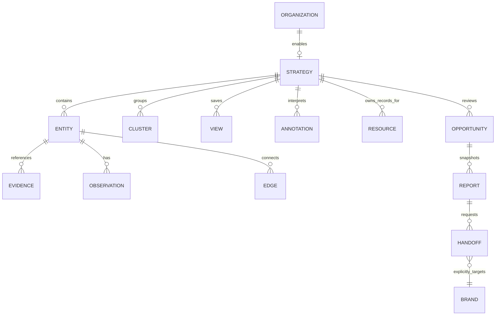

# Seed-to-product model

Proposed contract for #211/#214; not a schema installed by #210. [Representative records](records.json) are design examples, not observed artist data or cleared resources.

## Relationships

All records carry organization scope, stable ID and revision. An entity can be a region, person, artist, external company, source signal or resource. It never implies an application tenant or access grant. Edges have a typed directed meaning and observed/proposed/example state, not just source/target coordinates. Layout positions belong to saved views, not real-world relationships. Annotations target `{kind,id,revision}` or an ordered path of references; record author/time and distinguish question/hypothesis/decision from source evidence.

Evidence includes canonical/source URL or permitted reference, imported/retrieved/published/observed times separately, method, permitted excerpt, attribution and verification state. Unknown time is `null`, not an invented timestamp. Observation values carry units, window, measured/derived/estimated/user-reported/unknown state and input references. A scenario is separate from an observation.

Reports retain both a snapshot of selected content and revision links for traceability. A report is editable with its own revision. Refreshing the graph does not rewrite the saved report; a deliberate update records new references. Opportunity/handoff provenance is retained on the destination draft rather than promoting the seed's prose to `verifiedFacts`.

## Material changes from the supplied seed

| Seed field/model | Change | Reason and user-visible benefit | Compatibility treatment |
|---|---|---|---|
| Recursive `tenants`, `parentTenantId`, `childTenantIds` | Separate app organization/brand IDs from external-entity nodes | Prevents graph relationships granting access or reparenting pilot brands | Retain original IDs as `seedRef`; never import seed hierarchy into identity |
| Three tenant examples | One explicitly enabled Defiant workspace; external XXL/catalog references stay unverified entities | One clear operating context without asserting subsidiaries, ownership or legal relationships | Preserve original names only as labeled examples |
| `city_nodes.ownedNetworkAssets` strings | Proposed relationship/resource references with unknown ownership and permissions | Manager can see missing bridge capability rather than assume access to a DJ/studio | Keep original strings as source notes; create operational resources only from explicit owned import |
| `corridor_edges.transferProbability`, `avgAudienceMultiplier` | Scenario inputs labeled illustrative; default measured result absent | Map remains useful without false forecast precision | Preserve original values in reference source; no inference that a probability is calibrated |
| `playbookId` | Optional unresolved reference + explanatory state | Missing definitions cannot break the inspector or fabricate a playbook | Seed provides no playbook collection; show missing until supplied |
| Artist signal + platform video in one record | Separate artist entity and source-signal/evidence record | Multiple videos/aliases can describe one artist without conflation | Original signal IDs map to signal nodes; artist ID new and traceable |
| `views7d`, replay estimate, acceleration | Typed observations/scenarios with unknown windows/methods | Shows exactly what was observed versus missing | Preserve supplied values only in example layer; do not mark measured |
| `compoundNetworkGrowthMultiple`, projected listeners/CPM | Explicit scenario, no automatic calculation until formula/input provenance exists | Avoids a convincing but unsupported total | Original simulation text retained as example notes |
| Single `corridorEdgeId` for a two-hop result | Ordered path of actual edge IDs | User can follow Lagos→London→Toronto without an implied nonexistent direct edge | Resolve existing two-hop path; do not silently add a direct corridor |
| `preClearedNodes`, catalog connectors and chemistry score | Rights/availability evidence plus required use and missing-input state | Separates a promising match from a legally/operationally usable asset | Unknown/unverified by default; names and public audio do not grant remix/stem rights |
| `SEEDED_AND_PASSING` benchmark tickets | Historical source assertions, excluded from operational task acceptance | No fabricated proof | Link original issue attachment; never create completed jobs/tests |
| No annotations/views/report records | Add versioned interpretation and selection/report state | Manager can resume decisions and explain the plan | Additive proposed entities, no rewrite of source facts |
| `_engine`/MongoDB graph label | Provenance text, not executable configuration/storage selection | Existing store and manual workflow can ship a useful slice | Never load model/provider/collection configuration from imported seed |

## Concrete discrepancies

The exact source JSON is retained in [#214](https://github.com/ChaiWithJai/liquidity-studio/issues/214), SHA-256 `39d0ed52c4efd34bcd17351f88b4c6a1fd4b2c5c5de1bb3183541f2089b2da52` over the code-fence JSON without its final newline. It contains 3 tenant examples, 6 cities, 8 directed corridors, 6 signals, 3 simulations, 9 connectors and 3 benchmark examples (38 total). Its root references the two existing publishing accounts as missing child tenants. Do not resolve that omission by creating or reparenting them.

All corridor endpoints and simulation signal IDs resolve within the seed. That structural fact proves neither truth nor usability. Three distinct playbook IDs have no corresponding definitions. Simulations cover only Lagos, Mumbai and Kingston, not all six signals. The Lagos→Toronto simulation references London→Toronto as its single edge; the route requires Lagos→London first. All six example YouTube URLs have illustrative-looking IDs; no URL was fetched or validated here, and none is treated as an actual discovered video.

There is no retained formula/code establishing how replay, acceleration, chemistry, compound growth or audience projections were computed. Some parent-comment mathematical notation is incomplete/mangled. Do not reverse-engineer a plausible equation from fixture outputs and call it recovered. CPM comparisons mix advertising-market assumptions with listener scenarios; they are not interchangeable measurement units. Keep these values visible only as explicitly sourced examples/assumptions, or omit them from the main experience.

## Source access and observation limits

Official sources reviewed 2026-10-18; no API credential, live request or scouting run was used:

- [YouTube video resource](https://developers.google.com/youtube/data/reference/rest/v3/videos#statistics): public resource counters include views, likes and comments. A point-in-time total is not a seven-day window. Derive interval views only from compatible observations with known timestamps; do not backfill a missing baseline.
- [YouTube channel resource](https://developers.google.com/youtube/data/reference/rest/v3/channels#statistics): subscriber totals can be hidden/rounded. Preserve that precision/missingness rather than ranking by invented exact counts.
- [YouTube Analytics metrics](https://developers.google.com/youtube/analytics/metrics) and [channel reports](https://developers.google.com/youtube/analytics/channel_reports): authorized owner/channel reports include deeper engagement/retention measures. They do not establish access to arbitrary emerging artists' private analytics. Replay is not a public video-statistics field; an estimate must name its method and inputs.
- [Gemini Search grounding](https://ai.google.dev/gemini-api/docs/google-search): grounding returns cited web context. It is not an instrument measuring view windows, unique replays, ownership, relationships or stem clearance. Model choice, cost and source adapters remain deferred.

A human's imported excerpt and counters are user-reported evidence with source/method/time fields, not authenticated API collection. The initial experience must function with unknown measurements. Automatic retrieval from arbitrary user URLs must not be added by weakening the existing source-host/DNS/byte limits; a future provider adapter needs its own documented permitted request path.
