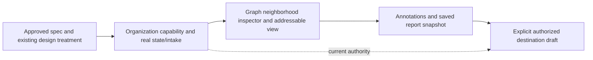

# Implementation plan: Defiant strategy workspace

Approved feature: [specification](../../../specs/defiant-strategy-workspace.md), [human approval](https://github.com/ChaiWithJai/liquidity-studio/pull/222#issuecomment-6253074556). Planning and implementation are authorized without further planning approvals. This plan records the work before feature code; it does not establish delivery. Module remains `operator-workflow`; root Issue 56 tasks are untouched.

## Outcome and source ownership

Deliver one useful **graph → annotation → saved report → explicit destination draft** journey, in small integrated slices. Reuse the [reconciled brief/model](../README.md); do not repeat its investigation or create a new service/database/provider platform.

The user subsequently identified a separate design-treatment worktree (`codex/defiant-design-treatment`, observed `65b62de`) owning the component API mocks and distinctive human/agent interaction. That work must drive frontend language and read models. Do not build a parallel graph/App implementation. The orchestrator coordinates its owner and integration. PLATFORM owns persisted backend state, organization authorization, intake/query/adapter/serialization and explicit draft handoff. DRAFT coordinates the contract and supports integration; its duplicate frontend implementation is on hold. No agent edits another owner's working tree.

The visible component surface currently uses node `kind/name/subtitle`, edge `kind/from/to/name`, stable selection/plan IDs and semantic callbacks. Preserve that surface where practical; adapt durable records behind it rather than imposing a second `type/label/sourceId` vocabulary. Mock success is design evidence only. Before wiring, agree the small component/API boundary with the actual owner, including provenance, revisions, error/pending states and real semantic agent actions.

## Dependency graph and vertical integrations

Integrate UI and backend together at each visible result. Parallel source work is safe only after agreeing shared request/read-model names; runtime acceptance and heavy work remain serialized by the orchestrator. No local server, build, install or test runner is authorized by this plan alone.

## Contract to implement, not a new public platform

- Use existing authenticated `/api/auth/session` organization discovery, including organizations without brands. Add minimized strategy capability state there. Do not require an invented brand to open organization research.
- Mount `/api/studio/strategy/:organizationId` after authentication and before the current brand-required publishing branch. Current organization membership and explicit enablement govern every strategy operation; the existing publishing authorization path stays intact. Founder enablement is deliberate, refuses the protected pilot organization, and never provisions/reparents it implicitly.
- GET returns authorized durable state plus a component-compatible read model, revision and authorized destination brands. No connected-Instagram assertion. The backend record names are not frozen independently of the user's component contract.
- `/import-preview` is nonmutating; `/import` validates typed graph/evidence/observations/resources and bounded unknown states. JSON intake first, no new CSV parser dependency. Mutations capture `expectedRevision` and `idempotencyKey`; annotation/view/report fields are exact bounded contracts. Server owns author/time/revision.
- New destination brands need an explicit empty initialization policy: current generic ScopedRepository seeds publishing backlog for an unconfigured brand, and createBrand defaults to the publishing preset. Do not disguise Defiant with a fake preset or overwrite existing scopes. D3 must supply a narrow server-owned empty-new-brand path under the enabled strategy organization before first scoped access; creation of the brand remains explicit. Existing publishing seed behavior stays unchanged.
- Annotation/report persistence preserves source interpretation separation and snapshot references. Handoff rechecks source and destination authority/revisions/restore lock in the same transaction as draft+receipt, uses existing store limits, and retains strategy provenance without editorial approval.

## Issue-backed task index

GitHub Issues is the task list target. Acceptance, verification, dependencies and likely files live in each item rather than a duplicate checklist here:

1. [#225: isolated workspace and evidence intake](https://github.com/ChaiWithJai/liquidity-studio/issues/225) — PLATFORM backend and the existing frontend owner integrate the first real state/empty/import screen. Dependency: approved spec and component boundary.
2. [#226: explore and resume the node map](https://github.com/ChaiWithJai/liquidity-studio/issues/226) — frontend owner leads; backend neighborhood/inspector adapter supports actual component requirements. Dependency: #225.
3. [#227: annotations and planning reports](https://github.com/ChaiWithJai/liquidity-studio/issues/227) — backend persistence and frontend report composition integrate. Dependency: #225 and #226.
4. [#228: explicit destination draft handoff](https://github.com/ChaiWithJai/liquidity-studio/issues/228) — PLATFORM service/transaction and frontend destination flow. Dependency: #227.

#211 owns the complete customer journey; #214 supplies graph/annotation/report acceptance. These children do not replace either parent. Keep source integrations focused at roughly five files; split an implementation task if it grows, not the product into separate dashboards.

## Checkpoints

- After #225–#226: current organization/isolation contracts pass in hosted CI; actual Neo opens the real workspace, imports explicit evidence and follows/resumes a readable route. No fixture metric or provider claim substitutes for this.
- After #227–#228: actual Neo annotates, saves/reopens a revision-bound report, chooses a real authorized destination and reopens the same unapproved draft after a lost reply. Preserve current publishing/native work and exercise relevant existing regressions, without an expanded generic matrix.
- At each meaningful screen: evaluate the whole composition and nested graph/inspector/report with sparse and busy data. Make at most three concrete improvements per loop. Keep the graph central and the next action obvious.
- Final: all required exact-head hosted checks, matching canonical frontend artifact, truthful source/provenance and customer-path evidence. Real manager/learner completion must be separately observed, never inferred from engineering QA. No new human planning approval checkpoint is imposed.

## Risks and recovery

| Risk | Treatment |
|---|---|
| Component mocks and backend disagree | Agree the read/action contract with the existing UI owner before wiring; adapt/serialize rather than duplicate UI. No runtime monkeypatch/mock success. |
| Organization flow accidentally uses publishing scope | Capability discovery before brand bootstrap; explicit organization authorization; disabled/foreign scope denies; protected pilot work remains unchanged. |
| Import or graph refresh overwrites human interpretation | Preview first, revision/CAS and bounded validation, stable seed mapping, annotations separate, no automatic reseed. |
| Report changes beneath a saved decision | Immutable selected snapshot plus revision references; explicit compare/update. Dirty text survives failures. |
| Rights/availability or scenario becomes a fact | Preserve example/user-reported/unknown state and intended-use constraints through report/draft; no score or cleared asset invented. |
| Duplicate or stale handoff | Actor/key/payload receipt atomically with draft, exact report revision and current destination checks; unknown response recovers the same intent. |
| Capacity or deployment failure | Existing 4 MiB/1–8 key transaction bounds; additive scoped state; no automatic cleanup/reset. Preserve records/backup before any separately authorized runtime operation. |

No new product question blocks the approved scope. Exact Defiant organization, evidence and destinations are explicit operational setup, not inferred from demo tenants. The next source step is the shared component/backend contract and #225, while native runtime remains the orchestrator's active slot.
